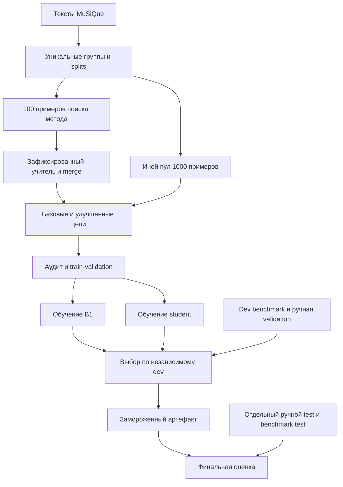
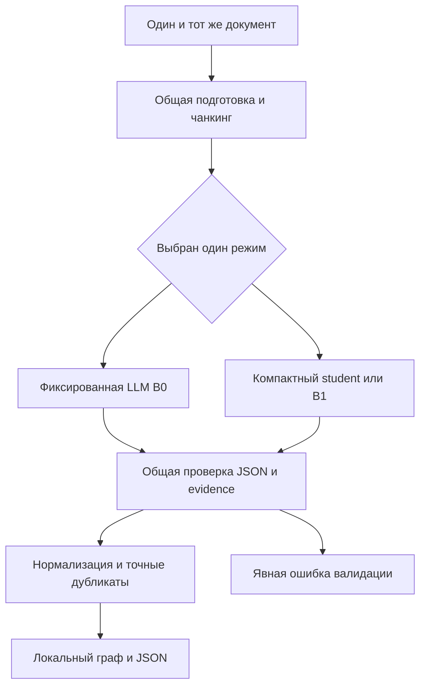
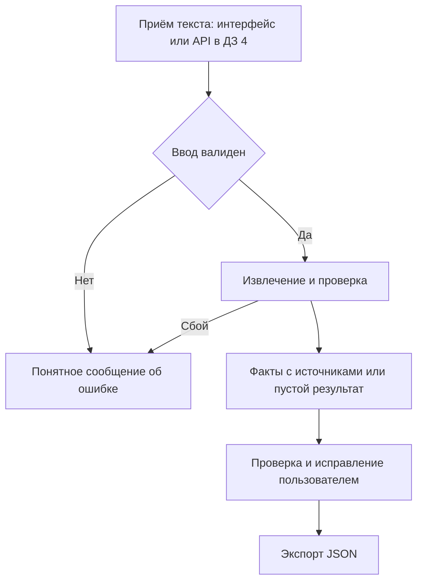
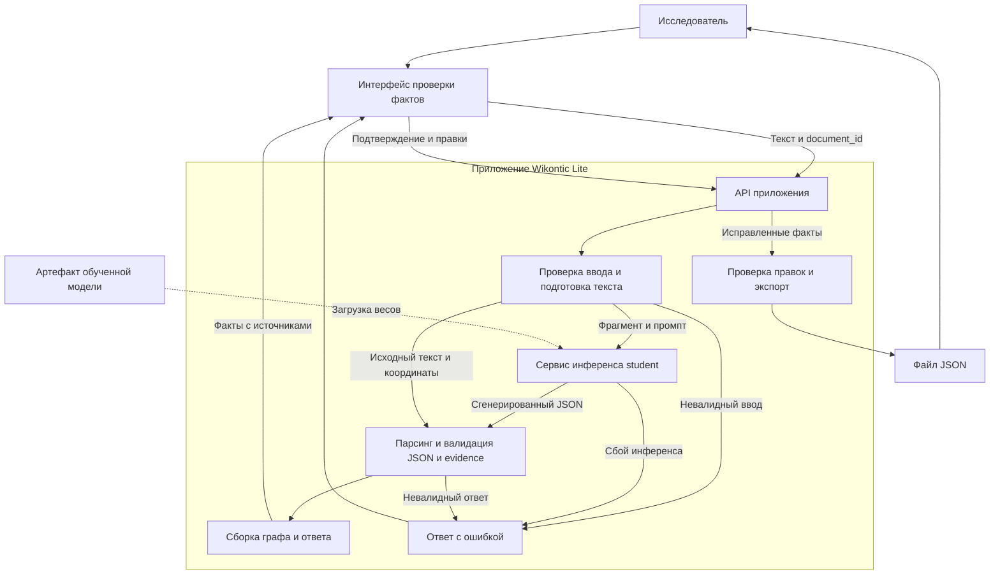

# Wikontic Lite — MVP, итерация 1

- **Статус:** EDA и проектирование этапов решения, ДЗ №2 по ML System Design.
- **Дата обновления:** 14 ноября 2026 года.
- **Проект:** Wikontic Lite (`MLSD_wikontic`).
- **Текущий этап:** анализ существующих учительских данных и подготовка протокола обучения.
- **Целевой MVP:** извлечение и проверка фактов компактной моделью к завершению ДЗ №4.

Постановка и архитектура подготовлены в ДЗ №1; в ДЗ №2 выполнен EDA трёх локальных
учительских дампов. Результаты анализа приведены в §2.3 и
[отчёте EDA](../reports/eda/README.md). Обучение и сервис относятся к следующим
итерациям. Численные цели качества и пилота остаются гипотезами, не результатами.

## Оглавление

- [1. Цели и предпосылки](#1-цели-и-предпосылки)
  - [1.1. Зачем разрабатывать продукт](#11-зачем-разрабатывать-продукт)
  - [1.2. Требования и ограничения](#12-требования-и-ограничения)
  - [1.3. Скоуп и исключения](#13-скоуп-и-исключения)
  - [1.4. Предпосылки решения](#14-предпосылки-решения)
- [2. Методология](#2-методология)
  - [2.1. ML-постановка и оценка](#21-ml-постановка-и-оценка)
  - [2.2. Планируемая архитектура](#22-планируемая-архитектура)
  - [2.3. Этапы решения задачи](#23-этапы-решения-задачи)
- [3. Подготовка пилота](#3-подготовка-пилота)
- [4. Внедрение](#4-внедрение)
- [Приложение А. Риски и открытые решения](#приложение-а-риски-и-открытые-решения)
- [Приложение Б. Источники и существующие наработки](#приложение-б-источники-и-существующие-наработки)

## 1. Цели и предпосылки

### 1.1. Зачем разрабатывать продукт

Целевой пользователь — исследователь или разработчик базы знаний, которому нужно
преобразовать небольшой корпус текстов в проверенный набор сущностей и отношений.
Например, при обзоре технологий специалисту недостаточно найти нужную статью:
нужно собрать, какой метод решает какую задачу, какие компоненты использует
и где об этом сказано. Эти сведения распределены по документам и описаны разными
словами. Таблица или граф позволяет сопоставлять связи между сущностями, но сначала
их приходится вручную выделить и проверить.

Сейчас предполагается следующий процесс: прочитать документы, выписать факты,
перенести их в таблицу или граф, сохранить источники, убрать дубликаты и согласовать
названия. При добавлении нового документа часть работы повторяется. Обычный поиск
помогает найти фрагменты, но не готовит структурированную выгрузку связей;
текстовое резюме также не заменяет набор отдельных проверяемых фактов.

#### Где это может применяться

| Область | Исходные тексты | Зачем нужен результат |
|---|---|---|
| Обзор научных методов | Англоязычные аннотации и выбранные фрагменты статей | Собрать связи «метод — решает — задачу» и «метод — использует — компонент» для предметной базы знаний |
| Анализ технических решений | Открытые описания библиотек и технологий | Подготовить связи «библиотека — поддерживает — формат» и «компонент — зависит от — компонента» для дальнейшего сопоставления |

Это предполагаемые области применения, а не результаты пользовательского исследования.
В обоих случаях граф служит исходным материалом для анализа: автоматические извлечения
нужно проверить, а исчерпывающее сравнение методов и совместимости не входит в MVP.
Для первой версии тексты передаются вручную, без загрузки сайтов или разбора PDF.

Ручная подготовка требует времени. Большая LLM может ускорить первичное извлечение,
но требует вычислительных ресурсов или API-расходов и может пропускать факты,
дублировать их либо предлагать неподтверждённые отношения. Масштаб этих проблем
и спрос на продукт пока не измерены.

Поэтому ценность проекта — не просто получить JSON от LLM, а сократить весь путь
от чтения корпуса до проверенной структурированной базы. Привязка к фрагментам
помогает проверять факты без повторного поиска по документам, а компактная модель
может снизить затраты при регулярной обработке новых текстов.

**Цель продукта:** сократить время получения проверенного набора фактов при
контролируемом качестве. ML нужен для разнообразных синтаксических конструкций
и перефразированных отношений, плохо покрываемых фиксированными правилами.
Дистилляция рассматривается как способ снизить стоимость и задержку извлечения.

**Гипотеза пилота:** медианное полное время подготовки проверенного
набора фактов сократится минимум на 20% относительно ручного процесса при
сопоставимом качестве итогового результата. Порог 20% выбран как рабочий ориентир
и уточняется до пилота. Сравниваются
сопоставимые тексты с одинаковыми критериями приёмки фактов. Порядок ручного
и автоматизированного условий балансируется между участниками, чтобы уменьшить
эффект обучения; повторное чтение одного текста учитывается в протоколе.
На учебном этапе основная мера пользы — время специалиста, а не финансовые показатели.

### 1.2. Требования и ограничения

#### Функциональные требования целевого MVP к концу ДЗ №4

| ID | Требование | Приоритет | Способ проверки |
|---|---|---|---|
| FR-01 | Принимать текст и `document_id` | Must | Валидный ввод принимается; пустой или превышающий лимит получает понятную ошибку |
| FR-02 | Возвращать сущности и направленные отношения | Must | JSON соответствует контракту; узлы определяются субъектами и объектами связей |
| FR-03 | Привязывать факт к документу и evidence | Must | Координаты разрешаются в исходный текст; смысловая подтверждённость проверяется отдельно |
| FR-04 | Различать отсутствие фактов и технический сбой | Must | Успешный пустой массив не подменяет ошибку инференса или парсинга |
| FR-05 | Позволять проверить и исправить результат | Must | Минимальный интерфейс либо редактируемый экспорт позволяет сопоставить факт с источником |
| FR-06 | Экспортировать результат | Must | JSON читается стандартным парсером и сохраняет идентификаторы источников |

#### Основной сценарий: подготовка базы знаний для обзора технологий

Исследователь собирает материалы для обзора методов извлечения информации. На входе —
небольшой набор англоязычных аннотаций и выбранных фрагментов статей в текстовом виде.
На выходе нужен проверенный набор связей между методами, задачами и компонентами,
который можно загрузить в предметную базу знаний и использовать для дальнейшего анализа.

1. Исследователь задаёт идентификатор источника и передаёт текст одного документа.
2. Сервис предлагает факты и показывает подтверждающие фрагменты. Например,
   из иллюстративной фразы `Method A uses a transformer encoder.` получается
   связь `Method A — uses — a transformer encoder` с координатами исходной фразы.
3. Исследователь сверяет факты с текстом: удаляет неверные связи, исправляет
   формулировки и добавляет пропущенные факты с источниками.
4. Проверенный результат экспортируется в JSON. Процесс повторяется для остальных
   документов; выгрузки используются при наполнении базы знаний.

Небольшой корпус применим к первому обзору узкой темы или очередному пополнению
существующей базы. Даже в таком объёме требуется не только прочитать тексты, но
и выписать связи, сохранить источники и проверить каждое утверждение. Выигрыш
зависит от числа полезных фактов и объёма исправлений, а не только от числа документов.
Для одного короткого текста ручная подготовка может оказаться проще; это граница
применимости, которую нужно учитывать при пилоте. Конкретный корпус и допустимые
отношения согласуются до пилота; MuSiQue используется для первых ML-экспериментов
и сам по себе не подтверждает качество на научно-технических текстах.

Полноценный визуальный редактор графа для этого сценария не требуется: достаточно
списка фактов с фрагментами и редактированием перед экспортом.

#### Альтернативные исходы

При пустом тексте или превышении лимита обработка отклоняется до инференса; превышение
не приводит к незаметному усечению текста. При отсутствии фактов возвращается успешный
пустой результат.
При сбое модели или невалидном результате возвращается явная техническая ошибка;
непроверенный факт не маркируется как подтверждённый.

#### Ограничения MVP

| Область | Принятое ограничение |
|---|---|
| Язык | Английский, согласованный с MuSiQue; русский отложен |
| Формат | Только текст; PDF, OCR и аудио не поддерживаются |
| Гранулярность | Документ либо явно выделенный фрагмент с координатами в документе |
| Объём входа | Лимит определяется после выбора student и EDA; чанкинг должен сохранять координаты |
| Нагрузка | Учебный исследовательский пилот, не коммерческий SLA |
| Serving | Локальная student-модель или выделенный endpoint; обязательного вызова учителя нет |
| Ресурсы | Локальный ПК: RTX 5070 Ti, Ryzen 7 9800X3D, 32 ГБ RAM; длительность обучения и бюджет API определяются отдельно |
| Данные | Открытые или согласованные тексты; закрытые данные нельзя отправлять учителю без разрешённого основания |
| Логи | Без ключей и полного пользовательского текста по умолчанию; сохраняются технические статусы и версии |
| Граф | Узлы и направленные связи в JSON, без обязательной графовой СУБД |

Производительность измеряется в ДЗ №4 при фиксированных оборудовании, версии модели,
длинах входа и выхода, batch size, concurrency и warm/cold режиме. До измерений
целевые задержки и пропускная способность остаются открытыми. Ожидание инференса входит
в пользовательское время, но не заменяет оценку времени исправления результата.

### 1.3. Скоуп и исключения

**ДЗ №1:** минимальный Python-пакет, конфигурации инструментов разработки, README,
дизайн-документ и протокол будущей оценки. Работа с данными и обучение относятся
к следующим этапам.

**ДЗ №2:** сопоставление дампов с исходниками, воспроизводимый EDA, диагностический
разбор примеров, кандидат группового разбиения и подробный план данных, моделей
и независимой оценки. Массовая генерация новых целей, обучение, API и пилот
в текущую работу не входят.

**Целевой MVP к концу ДЗ №4:** подготовленные данные и splits, зафиксированный
учительский метод, обученные B1 и основной student, сравнение на независимых
бенчмарках, минимальный инференс, проверка и экспорт фактов, измерения нагрузки
и документированный пилотный протокол. Проведение пилота зависит от доступности
участников и согласования данных.

Вне MVP: универсальный GraphRAG, QA как самостоятельный продукт, OCR, загрузка сайтов,
корпоративные интеграции, все языки, полноценный ontology alignment, глобальный entity
linking, автоматическое постоянное обновление графа, биллинг, HA-кластер и мобильное
приложение. Допускаются простая нормализация имён и удаление точных дубликатов.
Семантическое слияние разных сущностей не входит в первую версию. Типы сущностей и qualifiers из
старого исследования не входят в обязательный контракт первой версии; их включение
потребует одинакового контракта для всех сравниваемых вариантов.

Осознанный технический долг: один язык и ограниченный корпус пилота, ручная проверка,
нет автоматического переобучения и сложной авторизации. Публичное размещение потребует
отдельного решения по аутентификации, изоляции данных, лимитам и защите endpoint.

### 1.4. Предпосылки решения

| Предпосылка | Основание | Что проверяем | Риск, если неверна |
|---|---|---|---|
| MuSiQue даёт пригодные английские тексты | Восстановлены контексты; CC BY 4.0 | EDA подтвердил повторы; перенос на технический домен ещё проверяется | Нужен другой корпус; QA-ответы не являются полной SPO-разметкой |
| Учитель генерирует полезные цели | Есть исследовательские скрипты и отчёт upstream | Ручной аудит precision/recall и evidence в ДЗ №2–3 | Шум учителя закрепится в student |
| 1 000 примеров достаточно для первого опыта | Рабочий объём преобразования целей, не весь доступный пул | Параграфы с evidence, объём токенов, learning curve | Не хватит покрытия или примеров для обучения |
| Компактная модель сокращает ресурсы | Меньше параметров, но это не замер продукта | Единый serving-протокол в ДЗ №3–4 | Генерация и исправления съедят выигрыш |
| Evidence ускоряет проверку | Позволяет открыть исходный фрагмент | Пилот с учётом времени проверки | Точный фрагмент не обязательно доказывает отношение |
| Пользователю нужен JSON | Гипотеза интеграции с базой знаний | Проверка выгрузки в маленьком пилоте | Понадобится другой формат или сценарий |
| Независимый OpenIE-бенчмарк соответствует задаче | CaRB содержит ручные извлечения и evaluator | Совместимость SPO с аргументами и правилами matching в ДЗ №2 | Измеряется другая задача или теряется часть фактов |

Гранулярность модели — текстовый фрагмент и набор фактов из него. Обучение выполняется
офлайн, инференс — по запросу.

## 2. Методология

### 2.1. ML-постановка и оценка

#### Задача и контракт

Условная генерация структурированного набора SPO-фактов из текста с построением
локального графа. Вход `x`: `document_id`, текст; при сегментации также `chunk_id`
и координаты фрагмента. Выход `y`: набор `subject`, `predicate`, `object`, evidence
и источник. Триплеты сериализуются как целевая последовательность, а не являются
взаимоисключающими классами.

Пример целевого формата ответа для входного текста `Marie Curie was born in Warsaw.`:

```json
{
  "document_id": "demo-001",
  "triples": [
    {
      "subject": "Marie Curie",
      "predicate": "was born in",
      "object": "Warsaw",
      "evidence": {
        "text": "Marie Curie was born in Warsaw.",
        "start": 0,
        "end": 31
      }
    }
  ]
}
```

Источник всех фактов примера — верхнеуровневый `document_id`. Координаты по символам
Python-строки исходного документа: `start` включительно, `end` исключительно;
`text[start:end] == evidence.text`. После нормализации и чанкинга нужен явный перенос
координат обратно. Проверка подстроки необходима, но смысловое подтверждение связи
оценивается отдельно. Факты с некорректным evidence требуют исправления или отклонения.
Числовой `confidence` не вводится: вероятность токенов не равна достоверности факта.

#### Что переиспользуется и что меняется

Ветка upstream `distillation` содержит обучение SmolLM2-1.7B-Instruct через QLoRA,
completion-only loss, Focal Loss, подготовку splits и оценку совпадения с учительскими
триплетами. Эти эксперименты описаны в отчёте предыдущей работы. Их результаты
относятся к прежнему контракту и учительской разметке; в новой постановке нужна
повторная оценка по независимому эталону.

Для Wikontic Lite сохраняется идея **sequence-level distillation**: SFT на проверенных
ответах учителя, без доступа к его logits. Конкретная модель, LoRA/QLoRA, loss и decoding
уточняются по лицензии, контексту, качеству на dev-бенчмарке и доступной памяти.
В ДЗ №2 сформирован shortlist и предварительный выбор (§2.3.2); совместимость
обучения и качество кандидатов ещё не измерены.
SmolLM2 и Focal Loss остаются вариантами для сравнения. Исходный кандидат для обучения —
стандартный completion-only CE; пользу других loss-функций проверяем отдельными
абляциями. Фильтрация по списку отношений из train также требует проверки: она может
снижать recall новых корректных отношений на открытом бенчмарке.

#### Сравниваемые варианты

| Вариант | Назначение |
|---|---|
| Ручной процесс | База продуктовой оценки времени и качества итоговых исправленных фактов |
| Исходный Wikontic | Возможный системный reference, только после запуска и адаптации контракта |
| B0 | Один вызов фиксированной большой LLM с фиксированным промптом; pretrained reference, не обученный в проекте baseline |
| B1 | Та же компактная основа, что у student, с минимальным SFT на базовых учительских целях |
| Основной student | SFT на улучшенных проверенных целях; общие контракт, validation и постобработка с B0/B1 |

Сложный учитель с несколькими ответами и merge используется офлайн, а не при каждом
запросе. Версии модели, промптов, merge и фильтрации сохраняются. B1 позволяет
сравнить два обученных варианта и выделить эффект улучшенной разметки. В этом сравнении
B1 и student имеют одинаковые основу, splits и бюджет обучения; смена модели
и loss исследуется отдельными абляциями.

#### Данные и предотвращение утечек

Исходный план — 100 примеров для поиска промпта и merge, затем 1 000 иных
примеров для генерации зафиксированным методом. EDA показал значительно больший
доступный пул, но отсутствие evidence. Поэтому этот план трактуется как первый
цикл преобразования и аудита целей на уникальных параграфах (§2.3.1), а не как
объём уже готовой новой разметки. Сохраняются ID, seed, версия источника
и манифест групп; train/validation формируются раздельно внутри обучающего пула.

Разделение — по документам и группам совпадающих/связанных текстов, а не только
по ID QA-вопросов. Параграфы могут повторяться в разных вопросах MuSiQue и в старых
HotPotQA/MuSiQue-дампах. До переиспользования проверяются exact и near duplicates,
происхождение учительских целей и пересечения с бенчмарками. Article-level split
сам по себе не гарантирует отсутствия общих сущностей или дубликатов между корпусами.
В существующем `split_data.py` ключом группы служит `sample_id` QA-примера с набором
контекстов. Для независимого разбиения дополнительно нужны проверки повторяющихся
контекстов и групп связанных документов поверх этих ID.

#### Независимые бенчмарки вместо воспроизведения учителя

Основное качество оценивается по независимым эталонам. Все варианты проходят один
протокол на одинаковых входах. Ответы учителя используются для обучения, но не
считаются истинной разметкой теста.

| Набор | Роль и план проверки |
|---|---|
| CaRB, кандидат публичного OpenIE-бенчмарка | Ручная разметка и официальный evaluator; лицензия, адаптер и пригодность к SPO остаются открытой проверкой до benchmark-запуска |
| Документный продуктовый benchmark | Отдельные английские тексты с независимой ручной SPO-разметкой и evidence; нужны для оценки полноты и проверки источников на уровне документа |
| MuSiQue QA, дополнительная поздняя оценка | Answer F1/EM при фиксированном downstream QA; эти показатели отражают качество ответов, а не полноту всех фактов |
| Старые teacher-match отчёты | Только диагностика воспроизведения старого pipeline; не основной критерий качества |

CaRB допускает многоместные извлечения и использует собственные правила matching.
Перед использованием потребуется адаптер к SPO и оценка его покрытия. При ограничении бинарным
подмножеством публикуется отдельный результат с описанием отбора, без сравнения
с полным leaderboard.
Если формат требует score, фиксированное значение для всех фактов означает одну
рабочую точку, а не калиброванный confidence; ранжированные AUC и optimal F1 без
обоснованного ранжирования неприменимы. Evidence оценивается на отдельном наборе.

Состав и инструкция ручного benchmark фиксируются до финального теста; разметка
производится независимо от предсказаний моделей, спорные факты разбираются по единой
инструкции, по возможности вторым аннотатором. Размер теста и трудозатраты открыты.
Публичные dev и отдельная доменная validation используются для выбора модели,
промптов и параметров. Финальные test не используются для выбора checkpoint;
после заморозки конфигураций они применяются для итогового отчёта. Риск попадания
публичных тестов в предобучение остаётся ограничением сравнения.

#### Метрики и связь с пользой

| Метрика | Протокол измерения | Пользовательский смысл |
|---|---|---|
| Precision / подтверждённость | Доля фактов, следующих из текста по независимой ручной инструкции | Меньше удаления ложных связей |
| Recall фактов | Покрытие независимого эталона при согласованном one-to-one семантическом matching | Меньше ручного добавления пропусков |
| F1 фактов | Гармоническое precision и recall одного протокола; компоненты публикуются отдельно | Сводная оценка без сокрытия неполноты |
| Официальные метрики benchmark | Версия evaluator и его правила; отдельно от ручного семантического F1 | Сопоставимость с внешними системами |
| Доля дубликатов | Число избыточных фактов к числу предсказаний после согласованной нормализации | Меньше ручной очистки |
| Корректность evidence | Доля корректных координат и отдельно доля фрагментов, подтверждающих связь | Прослеживаемость и удобство проверки |
| Валидность структуры | Доля всех запросов с синтаксически и схемно валидным ответом | Меньше ошибок интеграции |
| Latency p50/p95 | От принятия валидного запроса до итогового результата; сбои и таймауты раскрываются | Время ожидания |
| Пропускная способность | Документы в минуту при заданных длинах, batch size и concurrency | Возможность обработать корпус |
| Serving cost | API или инфраструктурные расходы на 1000 сопоставимых документов, отдельно по вариантам | Экономика использования |
| Время пользователя | Чтение, ожидание, проверка, исправления, добавление пропусков и экспорт | Главная продуктовая метрика |

Правила micro/macro, пустых ответов и matching фиксируются до финального теста.
Для ручного набора при отсутствии предсказаний precision помечается N/A, а не 100%;
при непустом эталоне recall и F1 равны нулю. При пустом эталоне recall — N/A;
лишние предсказания всё равно учитываются как ошибки. Полностью пустые пары
учитываются отдельно; агрегирование раскрывает знаменатели и исключённые N/A.
Для публичного benchmark применяются его официальные правила, отличия объясняются.
Семантическое matching не объединяет логически разные утверждения. Учитель или
LLM judge может помогать в разборе, но не заменяет независимый эталон и ручной аудит.

**Предварительные технические цели:** на независимом доменном benchmark precision
student не ниже precision B0 более чем на 5 п.п., recall — также не ниже более чем
на 5 п.п.; медианное время обработки минимум вдвое меньше. Это сравнение двух
систем с одним независимым эталоном, а не student с ответами B0 как истиной.
Пороги выбраны как рабочие и должны быть пересмотрены после dev-оценки до теста.
Абсолютные критерии публичного benchmark определяются после проверки его пригодности.

При локальном student и удалённом B0 отдельно раскрываются сеть и различия
инфраструктуры: end-to-end ускорение не доказывает ускорение на одинаковом GPU.
Стоимость обучения и генерации целей считается отдельно от serving; при малом
числе запросов дистилляция может не окупиться. Технические цели не заменяют
гипотезу сокращения времени пользователя на 20%.

### 2.2. Планируемая архитектура

Схемы показывают планируемую архитектуру обучения, инференса и работы пользователя.
Схемы A–C описывают потоки данных и действий, схема D — компоненты приложения
и их ответственность. Все компоненты относятся к целевому MVP.

#### A. Офлайн-подготовка student и независимая оценка



Группы из ручного test исключаются из prompt-search и обучения. Публичный benchmark
также проверяется на пересечения с обучающими текстами. Test используется только
после выбора модели; базовые и улучшенные цели различаются методом учителя.

#### B. Сопоставимый инференс B0 и student



В эксперименте варианты запускаются отдельно на одинаковых документах. В serving
один пользовательский запрос не вызывает оба варианта по умолчанию. Учительский
merge из схемы A не включается в serving student.

#### C. Целевой пользовательский процесс



#### D. Сервисная архитектура целевого MVP



| Компонент | Ответственность |
|---|---|
| Интерфейс | Приём текста, показ фактов рядом с источниками, редактирование и подтверждение |
| API приложения | Приём запросов на извлечение и экспорт, передача результатов и ошибок интерфейсу |
| Подготовка текста | Проверка пустого ввода и лимитов, при необходимости чанкинг с сохранением исходных координат |
| Сервис инференса student | Загрузка обученной модели и генерация ответа по тексту и фиксированному промпту |
| Валидация и сборка ответа | Разбор JSON, проверка схемы и evidence, перенос координат, удаление точных дубликатов и формирование итогового графа |
| Экспорт | Повторная проверка структуры и координат после пользовательских правок, сериализация подтверждённого набора в JSON |

**Модель генерирует JSON-последовательность** с полями триплетов и evidence,
а не заполняет записи в базе данных и не вызывает экспорт самостоятельно.
Приложение разбирает её ответ и проверяет типы и обязательные поля, допустимость
координат и совпадение фрагмента с исходным текстом. Затем формирует итоговый JSON
по контракту §2.1. Валидность структуры и координат не доказывает истинность связи:
смысловую проверку выполняет пользователь. Если ответ модели не проходит проверки,
приложение возвращает явную ошибку, а не успешный пустой граф.

Для учебного MVP это логические компоненты одного приложения. Сервис инференса
может быть модулем того же процесса; отдельный endpoint нужен только при размещении
модели на другом вычислительном узле. Отдельные микросервисы, брокер сообщений
и постоянная БД не требуются. Исходный текст и правки можно хранить в пределах
сессии до экспорта без долговременного сохранения на сервере.

Учитель отсутствует на пути пользовательского запроса. Он используется офлайн
при подготовке обучающих целей в схеме A; в приложение передаётся артефакт
обученного student. B0 запускается отдельно для экспериментов, не параллельно
со student при обычном использовании.

### 2.3. Этапы решения задачи

#### 2.3.1. Этап 1. Подготовка данных

**Вход:** локальные учительские дампы, исходные HotpotQA/MuSiQue и сведения
об их происхождении. В ДЗ №2 сопоставлены все 2 045 QA-записей и 38 839 контекстных
записей; контрольные суммы и метод восстановления находятся в
[отчёте источников](../reports/source_matching.md), измерения и графики —
в [EDA](../reports/eda/README.md).

| Набор | QA-ID | Контексты | Уникальные точные тексты | Триплеты |
|---|---:|---:|---:|---:|
| H: HotpotQA distractor validation | 200 | 1 999 | 1 997 | 22 312 |
| M: MuSiQue-Ans dev | 200 | 3 996 | 3 201 | 38 217 |
| G: MuSiQue-Full train | 1 645 | 32 844 | 20 726 | 329 814 |

Числа QA-ID и контекстов не равны числу независимых документов. H и M взяты
из официальных dev/validation и уже использовались в исследовательской работе.
Они не становятся независимым тестом после нового случайного разбиения.

**Сущности и схема данных:**

| Сущность | Поля | Назначение |
|---|---|---|
| QA-запись источника | `id`, контексты, для MuSiQue-Full — `answerable` | Восстановление происхождения; вопрос и QA-ответ не являются SPO-эталоном |
| Контекст | QA-ID, индекс, заголовок, текст и SHA-256 | Единица текстового EDA и кандидат SFT-примера |
| Учительский факт | `subject`, `relation`, `object`, типы, `qualifiers` | Синтетическая цель старого контракта |
| Цель нового контракта | SPO, `document_id`, evidence и координаты | Обучение и serving после обогащения и проверки |
| Манифест | Хеши источников, ID контекста, группа, версия обработки | Воспроизведение состава выборки без публикации исходных текстов |

У G ключ `<id>_Answerable/Unanswerable` сопоставляется с парой `(id, answerable)`:
простое снятие суффикса смешает два разных варианта контекста. Неответимость
QA-вопроса не означает отсутствия извлекаемых фактов.

**Выявленные проблемы и действия:**

| Результат EDA | Решение |
|---|---|
| 37 SPO с пустым обязательным полем, 3 некорректных qualifier-элемента | Карантин записей до исправления; сохранять причину и исходную версию |
| 4 пустых ответа при непустых текстах | Не считать автоматически отрицательными примерами; проверить извлечение |
| Evidence отсутствует у всех 390 343 триплетных записей | Старые цели не готовы к новому контракту; нужен отдельный этап привязки к источнику |
| 316 повторных SPO без учёта типов/qualifiers | Удалять только полные дубликаты; разные времена и условия не сливать |
| 644 совпадения имён субъекта/объекта | Разбирать семантически; одноимённые песня и альбом могут образовывать корректную связь |
| Медианы JSON-цели 1 741–2 038 символов, максимум 26 249 | Токенизировать вход и выход вместе; не обрезать хвост генерации молча |
| 514 общих точных текстов M–G, дополнительные совпадения H после нормализации пробелов | Группировать тексты и статьи до разбиения и ограничения повторного веса |
| В 512 из 514 общих текстов M–G различаются SPO-наборы | Не сливать ответы учителей как независимые истинные факты; проверить источники расхождений |

В диагностическом разборе найдены потеря модальности, неправильные отношения,
таблицы с неявными единицами и зависимость от заголовка. Отсутствие буквального
имени в тексте не признаётся автоматически галлюцинацией. Подробности —
[30 выбранных примеров](../reports/eda/diagnostic_review.md); это не gold-разметка теста.

**Получение и обновление.** Исходники скачиваются по HTTP: официальный MuSiQue v1.0
ZIP и представление HotpotQA на Hugging Face. Сервер исходного HotpotQA во время
загрузки не разрешался через DNS; происхождение замены и преобразование схемы
зафиксированы. Учительские JSON поступают отдельными офлайн-партиями, не непрерывным
потоком пользовательских запросов. Для новой партии сохраняются входные ID/хеши,
идентификатор учителя, промпт, параметры decoding, merge, расходы и журналы ошибок.
Версии генераторов старых файлов пока не восстановлены полностью.

**Очистка и разбиение.** Исходные файлы неизменяемы; преобразования создают новые
артефакты с манифестом. Приоритетная единица обучения — самостоятельный параграф.
Если разметка фактически зависит от соседних параграфов или QA-контекста, такие факты
получают расширенный вход либо исключаются из этого режима обучения.

Пробная группировка объединяет равные тексты после нормализации пробелов или
равные заголовки без учёта регистра, включая транзитивные связи между наборами.
Получено 21 506 групп, крупнейшая — 155 записей. С seed 42 кандидат train/validation
содержит 34 996 / 3 843 записей до очистки; общих нормализованных текстов и заголовков
между частями нет. Локальный манифест — `data/processed/eda/group_manifest.jsonl`.
Это внутреннее разбиение учительского пула, не независимый test. После удаления
повторов, карантина и исключения пересечений с gold-набором манифест фиксируется
повторно. Близкие дубликаты, переименования статей и полнота группировки пока не проверены.

**Достаточность данных.** Объём больше исходного плана 1 000 примеров, но готовых
проверенных SPO+evidence целей пока нет. Узкое место — качество и контракт, а не
число сырых триплетов. Первый цикл: 100 групп для разработки метода учителя
и 1 000 иных уникальных параграфов для преобразования и аудита целей, преимущественно
из G. Это рабочий объём, не доказанная достаточность. В ДЗ №3 сравниваются вложенные
пулы 250/500/1 000 примеров с неизменной validation. Расширение до 2 000–5 000
целесообразно, только если learning curve, ошибки редких отношений и бюджет это
обоснуют. Отдельно нужны независимые оценки и примеры научно-технического домена;
они не заменяются дополнительной Wikipedia-разметкой.

**Лицензии и конфиденциальность.** HotpotQA — CC BY-SA 4.0, MuSiQue — CC BY 4.0;
при распространении производных наборов сохраняются attribution и применимые условия.
Учительские ответы дополнительно требуют проверки условий провайдера и авторства
предыдущих артефактов. Учительские дампы опубликованы под CC BY-SA 4.0 в
[HF Dataset](https://huggingface.co/datasets/bl4ckse4m/wikontic-lite-teacher-data/tree/48caaeef5a103a775392a4b7fa14c90fa94e259f),
ревизия `48caaeef5a103a775392a4b7fa14c90fa94e259f`.
14.11.2026 проверены публичное скачивание трёх файлов без авторизации, совпадение
SHA-256 и наличие текста лицензии.
Лицензия набора не заменяет условия исходников и не определяет лицензию кода проекта.
В GitHub публикуются агрегаты и небольшие документальные примеры,
не весь корпус. Открытые биографии могут содержать имена, даты и чувствительные
сведения; исчерпывающая privacy-проверка не проведена. Новые закрытые тексты
не отправляются учителю без разрешения; ключи и полный пользовательский текст
не сохраняются в логах по умолчанию.

**Выход и готовность:** EDA, схема, источники и хеши, правила карантина, групповой
манифест и перечень недостающей разметки. К SFT переходят только после фиксации
состава train/validation, устранения известных пересечений и валидации нового контракта.

#### 2.3.2. Этап 2. Подготовка моделей

**Вход:** очищенные парные примеры одного контракта, манифесты групп, независимая
dev-разметка и ограничения локального ПК. Обучение в ДЗ №2 не выполняется.

**Метрики.** Главные критерии — подтверждённость и recall по независимым фактам,
их F1, валидность JSON и корректность evidence из §2.1. Дополнительно раскрываются
micro/macro, показатели на частых/редких отношениях, длинных/коротких текстах,
таблицах и научно-техническом домене. Отдельно измеряются latency p50/p95 и стоимость
обработки. Ни eval-loss, ни совпадение с учителем не заменяют benchmark-качество.
Предварительные допуски −5 п.п. precision/recall и ускорение 2× уточняются по dev
до финального теста, а не после просмотра test-результатов.

**Функция потерь.** Исходный вариант B1 и student — completion-only autoregressive
cross-entropy: prompt и padding маскируются, loss считается по токенам ответа.
Это sequence-level SFT, не классификация отношений и не distillation по logits.
Focal Loss проверяется отдельной абляцией после стабильного CE-результата.
Длинный хвост в EDA мотивирует срезы ошибок, но сам по себе не доказывает преимущество
Focal Loss. Аналогично тестируются балансировка, порядок фактов и constrained decoding.

**Варианты сравнения:**

| Вариант | Вход и обработка | Что фиксируется |
|---|---|---|
| B0 | Один запрос к доступной большой LLM, общий контракт и валидация | Модель/версия, промпт, decoding, лимиты и время/API-затраты |
| B1 | Компактная основа, CE-SFT на базовых учительских целях с evidence | Основа, адаптер, train/validation, шаги и seed |
| Student | Та же основа и обучение, улучшенные проверенные цели | Отличается разметка, а не одновременно модель, splits и loss |
| Прежний SmolLM2 | Только дополнительный historical reference после восстановления артефакта | Старые teacher-match метрики не сопоставляются напрямую с новым benchmark |

Для чистого сравнения B1/student используются одинаковые исходные тексты и разбиение;
evidence добавляется к обоим вариантам по одной инструкции. M и G нельзя напрямую
назвать такой абляцией: отличаются тексты, учителя и история обработки. Смена основы
и loss рассматривается отдельными экспериментами.

**Предобработка и моделирование.** Сохраняются исходные символы и карта координат,
текст не приводится к нижнему регистру. Допускается нормализация имён в выходе,
не меняющая смысла. Словарь допустимых отношений из train не ограничивает
генерацию по умолчанию. Для SFT фиксируются chat-template, стабильная JSON-сериализация,
порядок полей и политика порядка фактов. Длины считаются токенизатором всей пары;
слишком длинные примеры сегментируются с переносом evidence или явно исключаются
с подсчётом потерь. Классические числовые FE/label encoding здесь не требуются.

**Валидация:**

1. Внутренняя teacher-validation по группам — диагностика loss и воспроизведения целей.
2. Независимый domain-dev — выбор модели, checkpoint, промптов и постобработки
   по качеству фактов, а не teacher-match. Итоговый test не используется для выбора.
3. Публичный benchmark — дополнительная внешняя сопоставимость после проверки
    формата и evaluator; научно-технический перенос раскрывается отдельно.

**Рабочий протокол независимой оценки.** Основной набор для выбора модели —
независимый domain-dev с размеченными SPO и evidence (§2.3.4). CaRB — отдельный
кандидат внешней оценки, не обязательная зависимость этого протокола. Ниже
зафиксированы правила будущего оценивания; размеченный domain-dev пока не подготовлен.

| Аспект | Правило |
|---|---|
| Эквивалентность сущностей | Имена и местоимения относятся к одной сущности только при разрешении по данному документу. Одинаковая строка не объединяет разные сущности, например песню и альбом |
| Эквивалентность отношений | Перефразировки принимаются при одинаковых участниках и смысле. Обратное направление допустимо только с семантически обратным предикатом: `A employs B` эквивалентно `B works for A`, но не `B employs A` |
| Отрицание и модальность | Отрицательное, условное и предположительное утверждения не приравниваются к положительному безусловному. Более общее отношение не заменяет существенно более конкретное |
| Время, количества, условия | Изменение даты, единицы измерения или существенного условия делает факт другим. При потере ограничения связь не получает полный match; факты вне принятого контракта учитываются по заранее определённой области разметки |
| Evidence | Координаты и равенство подстроки проверяются автоматически; смысловая поддержка связи фрагментом — отдельно. Другой фрагмент того же документа допустим, если он действительно подтверждает тот же факт |
| One-to-one matching | Из принятых пар «предсказание — эталон» строится двудольный граф и выбирается matching максимальной мощности. Один эталон не засчитывается дважды; избыточные дубликаты остаются unmatched |
| Спорные пары | Решения принимает аннотатор по тексту, без имени модели, с записанным обоснованием. Разногласия по возможности разрешает второй аннотатор. Неразрешённые случаи получают статус disputed, их число и влияние раскрываются отдельно |

Для разрешённых случаев на зафиксированном наборе TP — число сопоставленных пар,
FP — оставшиеся предсказания, FN — оставшиеся эталонные факты. Основные показатели —
micro precision, recall и F1 по суммарным TP/FP/FN; дополнительно публикуются
macro-результаты по документам с правилами пустых случаев из §2.1. Отдельно
раскрываются подтверждённость по тексту и качество evidence: корректный факт
может иметь неправильный фрагмент, что не должно теряться в одной F1.

Если корректное предсказание отсутствует в эталоне, это возможный пропуск разметки,
а не автоматическая ложь модели. Такие случаи проходят слепой разбор для всех
сравниваемых систем по одной процедуре. Исправления эталона версионируются,
после них пересчитываются все варианты. На test это исправление разметки,
не повод менять промпт, веса или правила matching под результат одной модели.
Учитель/LLM judge может предлагать кандидатов пар, но не является арбитром истины.
Основной сравнительный результат публикуется после разрешения спорных пар;
до этого раскрывается неопределённость, а не окончательный рейтинг моделей.

**Выбор checkpoint.** Сначала отбрасываются варианты, не выполняющие заранее
зафиксированные ограничения на валидность структуры, evidence, latency и допустимые
отклонения precision/recall от B0 на том же независимом dev. Численные эксплуатационные
пороги согласуются после ресурсного smoke-run, до основного подбора. Среди допустимых
вариантов выбирается максимальная micro-F1 domain-dev; при равной F1 — большая
precision, затем меньшая медианная latency. Если допустимого варианта нет, результат
отрицательный, а критерии не ослабляются задним числом. Eval-loss внутренней
teacher-validation служит диагностикой обучения, не заменой независимого качества.

При небольшом gold-наборе публикуются доверительные интервалы с ресемплированием
по документам/группам, а не по зависимым триплетам. Незначительное различие точечных
F1 при широких интервалах не считается доказанным преимуществом модели.

**Модели и оборудование.** `nvidia-smi` подтвердил RTX 5070 Ti, 16 303 MiB VRAM
и драйвер 580.95.05. CPU Ryzen 7 9800X3D и RAM 32 ГБ указаны владельцем.
Проверены публичные model cards/config, но веса не загружались:

| Кандидат | Лицензия | Контекст из config | Роль |
|---|---|---:|---|
| SmolLM2-1.7B-Instruct | Apache-2.0 | 8 192 | Небольшая основа, преемственность исследования |
| Qwen3-1.7B | Apache-2.0 | 40 960 | Предварительная основа нового B1/student; режим без thinking |
| Qwen3-4B-Instruct-2507 | Apache-2.0 | 262 144 | Более ёмкая альтернатива при допустимой памяти и времени |

Идентификаторы и ревизии сохранены в
[model_candidates.json](../reports/eda/tables/model_candidates.json).
Контекст модели из config не равен доступной длине обучения на 16 ГБ VRAM.
Предпочтительный старт — LoRA/QLoRA, microbatch 1, gradient accumulation,
gradient checkpointing; конкретная конфигурация принимается только после проверки
совместимости PyTorch/CUDA/bitsandbytes с Blackwell и измерения peak VRAM.
Ресурсный пробный запуск планируется на 2 048 токенов с проверкой покрытия данных;
4 096 рассматривается после замера. Это план, не пройденный GPU-тест.

Гиперпараметры оптимизируются ограниченно: сначала CE и одна основа, затем
learning rate, LoRA rank и длина генерации на dev. При недостатке памяти уменьшается
длина/размер основы, а не молча обрезаются цели. Фиксируются wall-clock, peak VRAM,
число шагов и seed. Бюджет двух обучений согласуется после пробного запуска;
лимит GPU-часов и окупаемость пока не измерены.

**Интерпретация и риски.** Ошибки группируются по неподтверждённым связям, пропускам,
перепутанным направлениям, отношениям, модальности, времени, таблицам и evidence.
Отдельно сравниваются raw и валидированные выходы, чтобы фильтрация не скрыла
потерю recall. Риски: шум целей, доменный сдвиг, усечение ответа, ограничения
GPU-стека, малый gold-набор и публичные данные в предобучении. Меры — аудит,
группировка, независимая оценка, явные лимиты, бюджетный smoke-run и раскрытие
неопределённости вместо вывода об успехе по одной метрике.

**Выход и готовность:** выбранная совместимая основа, фиксированные конфигурации
B0/B1/student, tokenizer-аудит, loss/validation/matching и ресурсный бюджет.
До их фиксации результаты разных teacher-наборов не интерпретируются как выигрыш модели.

#### 2.3.3. Этап 3. Учительская разметка и evidence

**Вход:** групповой пул текстов, исходные ответы и JSON-контракт. На 100 отдельных
группах сравниваются базовый промпт и улучшенный метод покрытия/merge. После выбора
метод замораживается и применяется к другому пулу. Каждый факт должен иметь
проверяемый фрагмент; заголовок, время, условия и модальность сохраняются либо
факт отклоняется. Статические offsets привязываются к исходному тексту, не к
нормализованной строке. Для одноимённых сущностей требуется различение по контексту.
Автоматическая проверка подстроки дополняется смысловым аудитом.
Если существенное условие или модальность нельзя корректно выразить в принятом
SPO-контракте, факт исключается из первого SFT-пула, а не превращается в безусловный.
Добавление qualifiers потребует единого расширения контракта B0/B1/student.

**Риски:** шум учителя, потеря recall при merge и деградация qualifiers в SPO.
**Выход:** версии базовых/улучшенных целей на одних текстах, журнал отклонений,
стоимость генерации и результаты аудита. Готовность к SFT — единый контракт
и отсутствие неразрешённых ошибок схемы/evidence; крупная генерация и обучение — ДЗ №3.

#### 2.3.4. Этап 4. Независимая benchmark-оценка

**Вход:** зафиксированный контракт и требования к предметному домену. CaRB остаётся
кандидатом публичного OpenIE-бенчмарка: данные и evaluator в этой работе не запускались.
До использования проверяются лицензия, бинарные/многоместные аргументы, адаптер,
покрытие и правила score. Неофициальный бинарный срез нельзя сравнивать с полным
leaderboard без оговорок. QA-метрики MuSiQue — только возможная поздняя downstream-оценка.

Для собственного документного benchmark начальный рабочий план — 20 независимых
dev-контекстов и 20 закрытых для подбора test-контекстов, не пересекающихся
с prompt-search/обучением по текстам и группам. Это бюджетный первый цикл, не
обоснованный размер для вывода о разнице в 5 п.п. После оценки трудозатрат и
неопределённости dev размер расширяется. Состав и инструкция фиксируются до
предсказаний; аннотатор выписывает факты и evidence из текста, спорные случаи
проходят согласование, по возможности вторым человеком. Разбор 30 учительских
примеров из EDA не заменяет этот независимый набор.

**Риски:** неполный эталон, предобучение на публичном тесте, высокие затраты
и перенос из Wikipedia в технический домен. **Выход и готовность:** версия benchmark,
разметочная инструкция, список групп, правила matching, протокол разногласий
и зафиксированный test. Без них не заявляется достижение целевого качества.

#### 2.3.5. Этап 5. Обучение, абляции и итоговое сравнение

В ДЗ №3 обучаются B1/student с одинаковыми текстами, бюджетом и seed, сохраняются
веса/адаптеры, конфигурации и входные манифесты. По dev выбирается checkpoint,
затем замораживаются модель и постобработка. Финальный test используется для
итогового отчёта, не повторного подбора. Отдельно проверяются размер пула,
основа, loss и decoding; при смене нескольких факторов вывод ограничивается
сравнением систем, а не причинной пользой конкретного изменения.

На одном наборе входов сравниваются B0/B1/student по независимым метрикам,
ошибкам, времени и serving cost. Генерация целей и стоимость обучения учитываются
отдельно; сеть удалённого B0 раскрывается. **Результат:** воспроизводимый отчёт
с precision/recall, неопределённостью и решением о пригодности student, включая
возможный отрицательный результат. Риск нехватки ресурсов снижается пробным
запуском до больших экспериментов и ограниченным набором абляций.

#### 2.3.6. Этап 6. Подготовка пилота и внедрения

На выходе ДЗ №3 — согласованный сценарий сравнения с ручным процессом и критерии
приёмки фактов. До пилота определяются тексты, участники, порядок заданий и учёт
времени ожидания/исправлений. В ДЗ №4 реализуются компоненты схемы D: минимальный
инференс, проверка и исправление фактов, экспорт и наблюдаемость ошибок.
Готовность демонстратора проверяется на валидном, пустом и превышающем лимит вводе,
сбоях модели и невалидном JSON/evidence. Затем измеряются latency/throughput
на фиксированном оборудовании. **Риск:** быстрый инференс без экономии времени
пользователя; **результат:** протокол и фактические замеры вместо обещаний SLA.

## 3. Подготовка пилота

Протокол пилота будет подготовлен в ДЗ №3. Планируется небольшой исследовательский пилот:
специалисты готовят проверенные наборы фактов вручную и с помощью сервиса на
сопоставимых английских текстах. До старта фиксируются инструкция, порядок условий,
размер выборки, критерии качества и бюджет. Успех — предварительно не менее 20%
экономии медианного полного времени при сопоставимом качестве. Если улучшилось
только время инференса, а исправления заняли больше времени, продуктовая гипотеза
не считается подтверждённой. Состав участников определяется при подготовке пилота.

## 4. Внедрение

Внедрение относится к ДЗ №4. Планируется минимальный локальный демонстратор
с простым интерфейсом проверки, API приложения и версионированной student-моделью.
Границы компонентов описаны в схеме D раздела 2.2. Для пилота достаточно одного
приложения без очередей и постоянной БД; инференс при необходимости выносится
на выделенный endpoint. Конкретные UI-фреймворк и способ размещения выбираются
после оценки ресурсов. Источник и пользовательские правки сохраняются в сессии
до экспорта, а не в обязательном серверном хранилище.
Контролируются ошибки, latency, throughput и затраты при описанной нагрузке;
численные SLO определяются после измерений. Ключи отделяются от конфигураций,
тексты не логируются по умолчанию. Публичный доступ без отдельного решения по
безопасности не предусмотрен.

## Приложение А. Риски и открытые решения

| Риск | Действие | Когда |
|---|---|---|
| Недостаточно обучающих примеров | Learning curve, аудит единицы примера, согласование расширения | ДЗ №2–3 |
| Шум учителя | Ручной аудит целей, версионирование и фильтрация | ДЗ №2–3 |
| Потеря recall и редких отношений | Независимый benchmark, срезы ошибок, абляция whitelist/loss | ДЗ №3 |
| Контекст student слишком мал | Анализ длин, чанкинг и явная политика переполнения | ДЗ №2 |
| Повторы между splits и корпусами | Группировка exact/near duplicates, манифесты | ДЗ №2 |
| Неподтверждённые связи при валидном evidence | Раздельная проверка координат и смысла | ДЗ №3–4 |
| Учитель недоступен или дорог | Зафиксировать разрешённые артефакты, запасной teacher-протокол | ДЗ №2 |
| VRAM ограничена, бюджет времени неизвестен | Подтверждены 16 303 MiB; совместимость и peak VRAM проверяются до двух обучений | ДЗ №2–3 |
| Сложная интеграция upstream | Не переносить весь стек; адаптировать только нужные контракты | ДЗ №2–4 |
| Benchmark не соответствует SPO или домену | Проверить адаптер и покрытие, дополнить ручным документным набором | ДЗ №2 |
| Публичный тест известен pretrained-модели | Раскрыть ограничения, добавить независимый свежий набор | ДЗ №2–3 |

Проверены аппаратная конфигурация GPU и лицензии моделей-кандидатов. Открыты:
окончательная основа после проверки совместимости, бюджет времени/API, достаточный
размер независимых dev/test, токеновые лимиты, реализация интерфейса, публичный
benchmark и SLO. Следующие решения принимаются по протоколам §2.3;
эффекты смены модели и улучшения разметки оцениваются раздельно.

## Приложение Б. Источники и существующие наработки

Основа проекта — исследовательская ветка `distillation` Wikontic. Ссылки ниже
ведут на изменяемую ветку. Перед переносом кода и воспроизведением экспериментов
нужно зафиксировать конкретную версию исходников и конфигураций.

- [Wikontic](https://github.com/screemix/Wikontic) — исходная исследовательская система.
- [Ветка distillation](https://github.com/screemix/Wikontic/tree/distillation) — предыдущие эксперименты.
- [Отчёт прошлой работы](https://github.com/screemix/Wikontic/blob/distillation/distillation/project_report.md)
  описывает обучение и оценку совпадения с учителем. Эти метрики относятся
  к прежней постановке, а не к независимым бенчмаркам Wikontic Lite.
- [Обучение](https://github.com/screemix/Wikontic/blob/distillation/distillation/train.py),
  [split](https://github.com/screemix/Wikontic/blob/distillation/distillation/split_data.py),
  [оценка](https://github.com/screemix/Wikontic/blob/distillation/distillation/infer.py),
  [конфигурация](https://github.com/screemix/Wikontic/blob/distillation/distillation/configs/train.yaml)
  — исходные материалы для адаптации подготовки данных и обучения.
- [LICENSE upstream](https://github.com/screemix/Wikontic/blob/distillation/LICENSE)
  — при переносе кода сохраняются исходные notices. Лицензия нового проекта пока
  не определена.
- [MuSiQue](https://github.com/stonybrooknlp/musique) — QA-корпус, README указывает CC BY 4.0;
  состав, происхождение текстов и ограничения проверяются при подготовке данных.
- [CaRB](https://github.com/dair-iitd/CaRB) и
  [статья](https://aclanthology.org/D19-1651/) — кандидат независимого OpenIE benchmark.
- [Reliable ML: шаблон](https://github.com/IrinaGoloshchapova/ml_system_design_doc_ru/blob/main/ML_System_Design_Doc_Template.md)
  — основа структуры документа.
- [Организация ML-проектов](https://mlops.ml-devs.com/),
  [Ruff](https://docs.astral.sh/ruff/configuration/), [pre-commit](https://pre-commit.com/).
