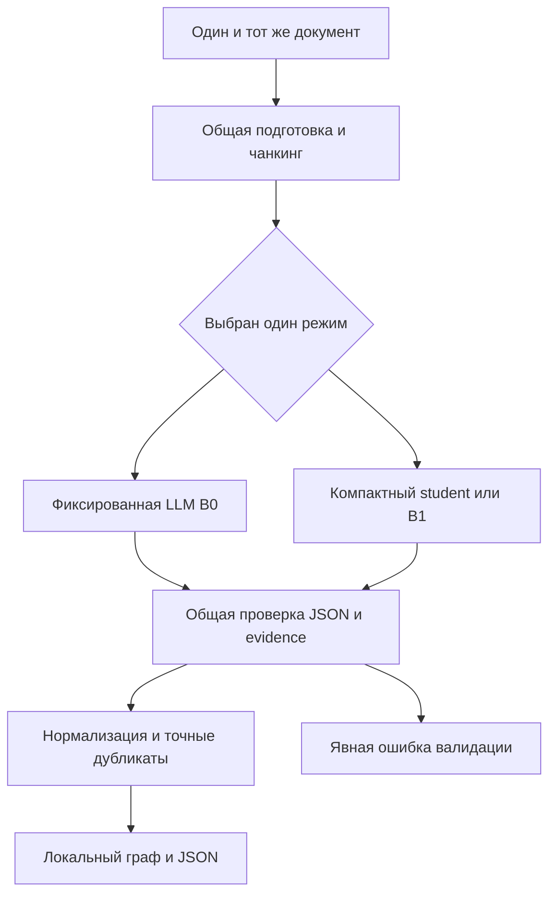
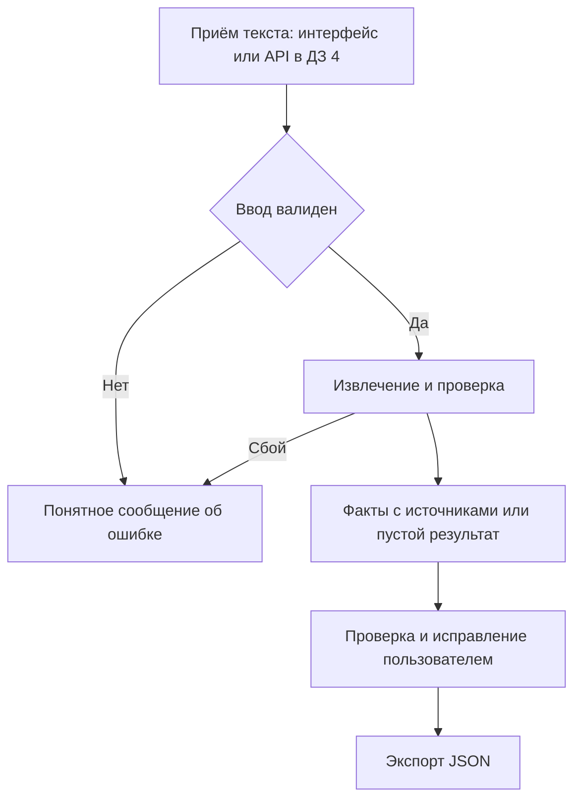
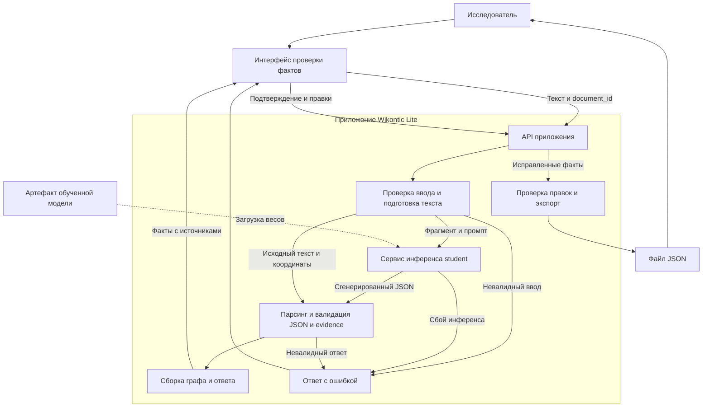

# Wikontic Lite — MVP, итерация 1

- **Статус:** проектирование, ДЗ №1 по ML System Design.
- **Дата обновления:** 10 ноября 2026 года.
- **Проект:** Wikontic Lite (`MLSD_wikontic`).
- **Текущий этап:** требования, методология оценки и настройка разработки.
- **Целевой MVP:** извлечение и проверка фактов компактной моделью к завершению ДЗ №4.

На первом этапе определяются требования и схема решения. Модель и сервис будут
реализованы в следующих итерациях. Численные ориентиры в документе — цели будущих
экспериментов и пилота; результаты предыдущей исследовательской работы рассматриваются
отдельно.

## Оглавление

- [1. Цели и предпосылки](#1-цели-и-предпосылки)
  - [1.1. Зачем разрабатывать продукт](#11-зачем-разрабатывать-продукт)
  - [1.2. Требования и ограничения](#12-требования-и-ограничения)
  - [1.3. Скоуп и исключения](#13-скоуп-и-исключения)
  - [1.4. Предпосылки решения](#14-предпосылки-решения)
- [2. Методология](#2-методология)
  - [2.1. ML-постановка и оценка](#21-ml-постановка-и-оценка)
  - [2.2. Планируемая архитектура](#22-планируемая-архитектура)
  - [2.3. Следующие этапы](#23-следующие-этапы)
- [3. Подготовка пилота](#3-подготовка-пилота)
- [4. Внедрение](#4-внедрение)
- [Приложение А. Риски и открытые решения](#приложение-а-риски-и-открытые-решения)
- [Приложение Б. Источники и существующие наработки](#приложение-б-источники-и-существующие-наработки)

## 1. Цели и предпосылки

### 1.1. Зачем разрабатывать продукт

Целевой пользователь — исследователь или разработчик базы знаний, которому нужно
преобразовать небольшой корпус текстов в проверенный набор сущностей и отношений.
Например, при обзоре технологий специалисту недостаточно найти нужную статью:
нужно собрать, какой метод решает какую задачу, какие компоненты использует
и где об этом сказано. Эти сведения распределены по документам и описаны разными
словами. Таблица или граф позволяет сопоставлять связи между сущностями, но сначала
их приходится вручную выделить и проверить.

Сейчас предполагается следующий процесс: прочитать документы, выписать факты,
перенести их в таблицу или граф, сохранить источники, убрать дубликаты и согласовать
названия. При добавлении нового документа часть работы повторяется. Обычный поиск
помогает найти фрагменты, но не готовит структурированную выгрузку связей;
текстовое резюме также не заменяет набор отдельных проверяемых фактов.

#### Где это может применяться

| Область | Исходные тексты | Зачем нужен результат |
|---|---|---|
| Обзор научных методов | Англоязычные аннотации и выбранные фрагменты статей | Собрать связи «метод — решает — задачу» и «метод — использует — компонент» для предметной базы знаний |
| Анализ технических решений | Открытые описания библиотек и технологий | Подготовить связи «библиотека — поддерживает — формат» и «компонент — зависит от — компонента» для дальнейшего сопоставления |

Это предполагаемые области применения, а не результаты пользовательского исследования.
В обоих случаях граф служит исходным материалом для анализа: автоматические извлечения
нужно проверить, а исчерпывающее сравнение методов и совместимости не входит в MVP.
Для первой версии тексты передаются вручную, без загрузки сайтов или разбора PDF.

Ручная подготовка требует времени. Большая LLM может ускорить первичное извлечение,
но требует вычислительных ресурсов или API-расходов и может пропускать факты,
дублировать их либо предлагать неподтверждённые отношения. Масштаб этих проблем
и спрос на продукт пока не измерены.

Поэтому ценность проекта — не просто получить JSON от LLM, а сократить весь путь
от чтения корпуса до проверенной структурированной базы. Привязка к фрагментам
помогает проверять факты без повторного поиска по документам, а компактная модель
может снизить затраты при регулярной обработке новых текстов.

**Цель продукта:** сократить время получения проверенного набора фактов при
контролируемом качестве. ML нужен для разнообразных синтаксических конструкций
и перефразированных отношений, плохо покрываемых фиксированными правилами.
Дистилляция рассматривается как способ снизить стоимость и задержку извлечения.

**Гипотеза пилота:** медианное полное время подготовки проверенного
набора фактов сократится минимум на 20% относительно ручного процесса при
сопоставимом качестве итогового результата. Порог 20% выбран как рабочий ориентир
и уточняется до пилота. Сравниваются
сопоставимые тексты с одинаковыми критериями приёмки фактов. Порядок ручного
и автоматизированного условий балансируется между участниками, чтобы уменьшить
эффект обучения; повторное чтение одного текста учитывается в протоколе.
На учебном этапе основная мера пользы — время специалиста, а не финансовые показатели.

### 1.2. Требования и ограничения

#### Функциональные требования целевого MVP к концу ДЗ №4

| ID | Требование | Приоритет | Способ проверки |
|---|---|---|---|
| FR-01 | Принимать текст и `document_id` | Must | Валидный ввод принимается; пустой или превышающий лимит получает понятную ошибку |
| FR-02 | Возвращать сущности и направленные отношения | Must | JSON соответствует контракту; узлы определяются субъектами и объектами связей |
| FR-03 | Привязывать факт к документу и evidence | Must | Координаты разрешаются в исходный текст; смысловая подтверждённость проверяется отдельно |
| FR-04 | Различать отсутствие фактов и технический сбой | Must | Успешный пустой массив не подменяет ошибку инференса или парсинга |
| FR-05 | Позволять проверить и исправить результат | Must | Минимальный интерфейс либо редактируемый экспорт позволяет сопоставить факт с источником |
| FR-06 | Экспортировать результат | Must | JSON читается стандартным парсером и сохраняет идентификаторы источников |

#### Основной сценарий: подготовка базы знаний для обзора технологий

Исследователь собирает материалы для обзора методов извлечения информации. На входе —
небольшой набор англоязычных аннотаций и выбранных фрагментов статей в текстовом виде.
На выходе нужен проверенный набор связей между методами, задачами и компонентами,
который можно загрузить в предметную базу знаний и использовать для дальнейшего анализа.

1. Исследователь задаёт идентификатор источника и передаёт текст одного документа.
2. Сервис предлагает факты и показывает подтверждающие фрагменты. Например,
   из иллюстративной фразы `Method A uses a transformer encoder.` получается
   связь `Method A — uses — a transformer encoder` с координатами исходной фразы.
3. Исследователь сверяет факты с текстом: удаляет неверные связи, исправляет
   формулировки и добавляет пропущенные факты с источниками.
4. Проверенный результат экспортируется в JSON. Процесс повторяется для остальных
   документов; выгрузки используются при наполнении базы знаний.

Небольшой корпус применим к первому обзору узкой темы или очередному пополнению
существующей базы. Даже в таком объёме требуется не только прочитать тексты, но
и выписать связи, сохранить источники и проверить каждое утверждение. Выигрыш
зависит от числа полезных фактов и объёма исправлений, а не только от числа документов.
Для одного короткого текста ручная подготовка может оказаться проще; это граница
применимости, которую нужно учитывать при пилоте. Конкретный корпус и допустимые
отношения согласуются до пилота; MuSiQue используется для первых ML-экспериментов
и сам по себе не подтверждает качество на научно-технических текстах.

Полноценный визуальный редактор графа для этого сценария не требуется: достаточно
списка фактов с фрагментами и редактированием перед экспортом.

#### Альтернативные исходы

При пустом тексте или превышении лимита обработка отклоняется до инференса; превышение
не приводит к незаметному усечению текста. При отсутствии фактов возвращается успешный
пустой результат.
При сбое модели или невалидном результате возвращается явная техническая ошибка;
непроверенный факт не маркируется как подтверждённый.

#### Ограничения MVP

| Область | Принятое ограничение |
|---|---|
| Язык | Английский, согласованный с MuSiQue; русский отложен |
| Формат | Только текст; PDF, OCR и аудио не поддерживаются |
| Гранулярность | Документ либо явно выделенный фрагмент с координатами в документе |
| Объём входа | Лимит определяется после выбора student и EDA; чанкинг должен сохранять координаты |
| Нагрузка | Учебный исследовательский пилот, не коммерческий SLA |
| Serving | Локальная student-модель или выделенный endpoint; обязательного вызова учителя нет |
| Ресурсы | Оборудование, GPU-бюджет и бюджет учительских вызовов не подтверждены |
| Данные | Открытые или согласованные тексты; закрытые данные нельзя отправлять учителю без разрешённого основания |
| Логи | Без ключей и полного пользовательского текста по умолчанию; сохраняются технические статусы и версии |
| Граф | Узлы и направленные связи в JSON, без обязательной графовой СУБД |

Производительность измеряется в ДЗ №4 при фиксированных оборудовании, версии модели,
длинах входа и выхода, batch size, concurrency и warm/cold режиме. До измерений
целевые задержки и пропускная способность остаются открытыми. Ожидание инференса входит
в пользовательское время, но не заменяет оценку времени исправления результата.

### 1.3. Скоуп и исключения

**ДЗ №1:** минимальный Python-пакет, конфигурации инструментов разработки, README,
дизайн-документ и протокол будущей оценки. Работа с данными и обучение относятся
к следующим этапам.

**Целевой MVP к концу ДЗ №4:** подготовленные данные и splits, зафиксированный
учительский метод, обученные B1 и основной student, сравнение на независимых
бенчмарках, минимальный инференс, проверка и экспорт фактов, измерения нагрузки
и документированный пилотный протокол. Проведение пилота зависит от доступности
участников и согласования данных.

Вне MVP: универсальный GraphRAG, QA как самостоятельный продукт, OCR, загрузка сайтов,
корпоративные интеграции, все языки, полноценный ontology alignment, глобальный entity
linking, автоматическое постоянное обновление графа, биллинг, HA-кластер и мобильное
приложение. Допускаются простая нормализация имён и удаление точных дубликатов.
Семантическое слияние разных сущностей не входит в первую версию. Типы сущностей и qualifiers из
старого исследования не входят в обязательный контракт первой версии; их включение
потребует одинакового контракта для всех сравниваемых вариантов.

Осознанный технический долг: один язык и ограниченный корпус пилота, ручная проверка,
нет автоматического переобучения и сложной авторизации. Публичное размещение потребует
отдельного решения по аутентификации, изоляции данных, лимитам и защите endpoint.

### 1.4. Предпосылки решения

| Предпосылка | Основание | Что проверяем | Риск, если неверна |
|---|---|---|---|
| MuSiQue даёт пригодные английские тексты | Документация описывает QA-корпус и CC BY 4.0 | Формат, состав, лицензии источников и повторные параграфы в ДЗ №2 | Нужен другой корпус; QA-ответы не являются полной SPO-разметкой |
| Учитель генерирует полезные цели | Есть исследовательские скрипты и отчёт upstream | Ручной аудит precision/recall и evidence в ДЗ №2–3 | Шум учителя закрепится в student |
| 1000 примеров достаточно для первого опыта | Параметр исходного исследовательского плана | Единица примера, объём токенов, learning curve | Не хватит покрытия или примеров для обучения |
| Компактная модель сокращает ресурсы | Меньше параметров, но это не замер продукта | Единый serving-протокол в ДЗ №3–4 | Генерация и исправления съедят выигрыш |
| Evidence ускоряет проверку | Позволяет открыть исходный фрагмент | Пилот с учётом времени проверки | Точный фрагмент не обязательно доказывает отношение |
| Пользователю нужен JSON | Гипотеза интеграции с базой знаний | Проверка выгрузки в маленьком пилоте | Понадобится другой формат или сценарий |
| Независимый OpenIE-бенчмарк соответствует задаче | CaRB содержит ручные извлечения и evaluator | Совместимость SPO с аргументами и правилами matching в ДЗ №2 | Измеряется другая задача или теряется часть фактов |

Гранулярность модели — текстовый фрагмент и набор фактов из него. Обучение выполняется
офлайн, инференс — по запросу.

## 2. Методология

### 2.1. ML-постановка и оценка

#### Задача и контракт

Условная генерация структурированного набора SPO-фактов из текста с построением
локального графа. Вход `x`: `document_id`, текст; при сегментации также `chunk_id`
и координаты фрагмента. Выход `y`: набор `subject`, `predicate`, `object`, evidence
и источник. Триплеты сериализуются как целевая последовательность, а не являются
взаимоисключающими классами.

Пример целевого формата ответа для входного текста `Marie Curie was born in Warsaw.`:

```json
{
  "document_id": "demo-001",
  "triples": [
    {
      "subject": "Marie Curie",
      "predicate": "was born in",
      "object": "Warsaw",
      "evidence": {
        "text": "Marie Curie was born in Warsaw.",
        "start": 0,
        "end": 31
      }
    }
  ]
}
```

Источник всех фактов примера — верхнеуровневый `document_id`. Координаты по символам
Python-строки исходного документа: `start` включительно, `end` исключительно;
`text[start:end] == evidence.text`. После нормализации и чанкинга нужен явный перенос
координат обратно. Проверка подстроки необходима, но смысловое подтверждение связи
оценивается отдельно. Факты с некорректным evidence требуют исправления или отклонения.
Числовой `confidence` не вводится: вероятность токенов не равна достоверности факта.

#### Что переиспользуется и что меняется

Ветка upstream `distillation` содержит обучение SmolLM2-1.7B-Instruct через QLoRA,
completion-only loss, Focal Loss, подготовку splits и оценку совпадения с учительскими
триплетами. Эти эксперименты описаны в отчёте предыдущей работы. Их результаты
относятся к прежнему контракту и учительской разметке; в новой постановке нужна
повторная оценка по независимому эталону.

Для Wikontic Lite сохраняется идея **sequence-level distillation**: SFT на проверенных
ответах учителя, без доступа к его logits. Конкретная модель, LoRA/QLoRA, loss и decoding
выбираются в ДЗ №2 по лицензии, контексту, качеству на dev-бенчмарке и доступной памяти.
SmolLM2 и Focal Loss остаются вариантами для сравнения. Исходный кандидат для обучения —
стандартный completion-only CE; пользу других loss-функций проверяем отдельными
абляциями. Фильтрация по списку отношений из train также требует проверки: она может
снижать recall новых корректных отношений на открытом бенчмарке.

#### Сравниваемые варианты

| Вариант | Назначение |
|---|---|
| Ручной процесс | База продуктовой оценки времени и качества итоговых исправленных фактов |
| Исходный Wikontic | Возможный системный reference, только после запуска и адаптации контракта |
| B0 | Один вызов фиксированной большой LLM с фиксированным промптом; pretrained reference, не обученный в проекте baseline |
| B1 | Та же компактная основа, что у student, с минимальным SFT на базовых учительских целях |
| Основной student | SFT на улучшенных проверенных целях; общие контракт, validation и постобработка с B0/B1 |

Сложный учитель с несколькими ответами и merge используется офлайн, а не при каждом
запросе. Версии модели, промптов, merge и фильтрации сохраняются. B1 позволяет
сравнить два обученных варианта и выделить эффект улучшенной разметки. В этом сравнении
B1 и student имеют одинаковые основу, splits и бюджет обучения; смена модели
и loss исследуется отдельными абляциями.

#### Данные и предотвращение утечек

Исходный план: 100 примеров MuSiQue для поиска промпта и merge, затем 1000 иных
примеров для генерации зафиксированным методом. Достаточность этого объёма
и возможность использовать прежние дампы проверяются на этапе анализа данных.
После EDA определяется единица «пример»: документ, параграф либо контекст вопроса.
Сохраняются ID, seed, версия источника и манифест разбиения; train/validation
формируются раздельно внутри обучающего пула.

Разделение — по документам и группам совпадающих/связанных текстов, а не только
по ID QA-вопросов. Параграфы могут повторяться в разных вопросах MuSiQue и в старых
HotPotQA/MuSiQue-дампах. До переиспользования проверяются exact и near duplicates,
происхождение учительских целей и пересечения с бенчмарками. Article-level split
сам по себе не гарантирует отсутствия общих сущностей или дубликатов между корпусами.
В существующем `split_data.py` ключом группы служит `sample_id` QA-примера с набором
контекстов. Для независимого разбиения дополнительно нужны проверки повторяющихся
контекстов и групп связанных документов поверх этих ID.

#### Независимые бенчмарки вместо воспроизведения учителя

Основное качество оценивается по независимым эталонам. Все варианты проходят один
протокол на одинаковых входах. Ответы учителя используются для обучения, но не
считаются истинной разметкой теста.

| Набор | Роль и план проверки |
|---|---|
| CaRB, кандидат основного публичного OpenIE-бенчмарка | Ручная разметка и официальный evaluator; в ДЗ №2 проверить лицензию, формат, dev/test и пригодность к SPO |
| Документный продуктовый benchmark | Отдельные английские тексты с независимой ручной SPO-разметкой и evidence; нужны для оценки полноты и проверки источников на уровне документа |
| MuSiQue QA, дополнительная поздняя оценка | Answer F1/EM при фиксированном downstream QA; эти показатели отражают качество ответов, а не полноту всех фактов |
| Старые teacher-match отчёты | Только диагностика воспроизведения старого pipeline; не основной критерий качества |

CaRB допускает многоместные извлечения и использует собственные правила matching.
В ДЗ №2 потребуется адаптер к SPO и оценка его покрытия. При ограничении бинарным
подмножеством публикуется отдельный результат с описанием отбора, без сравнения
с полным leaderboard.
Если формат требует score, фиксированное значение для всех фактов означает одну
рабочую точку, а не калиброванный confidence; ранжированные AUC и optimal F1 без
обоснованного ранжирования неприменимы. Evidence оценивается на отдельном наборе.

Состав и инструкция ручного benchmark фиксируются до финального теста; разметка
производится независимо от предсказаний моделей, спорные факты разбираются по единой
инструкции, по возможности вторым аннотатором. Размер теста и трудозатраты открыты.
Публичные dev и отдельная доменная validation используются для выбора модели,
промптов и параметров. Финальные test не используются для выбора checkpoint;
после заморозки конфигураций они применяются для итогового отчёта. Риск попадания
публичных тестов в предобучение остаётся ограничением сравнения.

#### Метрики и связь с пользой

| Метрика | Протокол измерения | Пользовательский смысл |
|---|---|---|
| Precision / подтверждённость | Доля фактов, следующих из текста по независимой ручной инструкции | Меньше удаления ложных связей |
| Recall фактов | Покрытие независимого эталона при согласованном one-to-one семантическом matching | Меньше ручного добавления пропусков |
| F1 фактов | Гармоническое precision и recall одного протокола; компоненты публикуются отдельно | Сводная оценка без сокрытия неполноты |
| Официальные метрики benchmark | Версия evaluator и его правила; отдельно от ручного семантического F1 | Сопоставимость с внешними системами |
| Доля дубликатов | Число избыточных фактов к числу предсказаний после согласованной нормализации | Меньше ручной очистки |
| Корректность evidence | Доля корректных координат и отдельно доля фрагментов, подтверждающих связь | Прослеживаемость и удобство проверки |
| Валидность структуры | Доля всех запросов с синтаксически и схемно валидным ответом | Меньше ошибок интеграции |
| Latency p50/p95 | От принятия валидного запроса до итогового результата; сбои и таймауты раскрываются | Время ожидания |
| Пропускная способность | Документы в минуту при заданных длинах, batch size и concurrency | Возможность обработать корпус |
| Serving cost | API или инфраструктурные расходы на 1000 сопоставимых документов, отдельно по вариантам | Экономика использования |
| Время пользователя | Чтение, ожидание, проверка, исправления, добавление пропусков и экспорт | Главная продуктовая метрика |

Правила micro/macro, пустых ответов и matching фиксируются до финального теста.
Для ручного набора при отсутствии предсказаний precision помечается N/A, а не 100%;
при непустом эталоне recall и F1 равны нулю. При пустом эталоне recall — N/A;
лишние предсказания всё равно учитываются как ошибки. Полностью пустые пары
учитываются отдельно; агрегирование раскрывает знаменатели и исключённые N/A.
Для публичного benchmark применяются его официальные правила, отличия объясняются.
Семантическое matching не объединяет логически разные утверждения. Учитель или
LLM judge может помогать в разборе, но не заменяет независимый эталон и ручной аудит.

**Предварительные технические цели:** на независимом доменном benchmark precision
student не ниже precision B0 более чем на 5 п.п., recall — также не ниже более чем
на 5 п.п.; медианное время обработки минимум вдвое меньше. Это сравнение двух
систем с одним независимым эталоном, а не student с ответами B0 как истиной.
Пороги выбраны как рабочие и должны быть пересмотрены после dev-оценки до теста.
Абсолютные критерии публичного benchmark определяются после проверки его пригодности.

При локальном student и удалённом B0 отдельно раскрываются сеть и различия
инфраструктуры: end-to-end ускорение не доказывает ускорение на одинаковом GPU.
Стоимость обучения и генерации целей считается отдельно от serving; при малом
числе запросов дистилляция может не окупиться. Технические цели не заменяют
гипотезу сокращения времени пользователя на 20%.

### 2.2. Планируемая архитектура

Схемы показывают планируемую архитектуру обучения, инференса и работы пользователя.
Схемы A–C описывают потоки данных и действий, схема D — компоненты приложения
и их ответственность. Все компоненты относятся к целевому MVP.

#### A. Офлайн-подготовка student и независимая оценка

```mermaid
flowchart TD
    M[Тексты MuSiQue] --> G[Уникальные группы и splits]
    G --> P[100 примеров поиска метода]
    P --> T[Зафиксированный учитель и merge]
    G --> D[Иной пул 1000 примеров]
    T --> L[Базовые и улучшенные цели]
    D --> L
    L --> V[Аудит и train-validation]
    V --> B[Обучение B1]
    V --> S[Обучение student]
    B --> C[Выбор по независимому dev]
    S --> C
    E[Dev benchmark и ручная validation] --> C
    C --> A[Замороженный артефакт]
    A --> F[Финальная оценка]
    X[Отдельный ручной test и benchmark test] --> F
```



Группы из ручного test исключаются из prompt-search и обучения. Публичный benchmark
также проверяется на пересечения с обучающими текстами. Test используется только
после выбора модели; базовые и улучшенные цели различаются методом учителя.

#### B. Сопоставимый инференс B0 и student



В эксперименте варианты запускаются отдельно на одинаковых документах. В serving
один пользовательский запрос не вызывает оба варианта по умолчанию. Учительский
merge из схемы A не включается в serving student.

#### C. Целевой пользовательский процесс



#### D. Сервисная архитектура целевого MVP



| Компонент | Ответственность |
|---|---|
| Интерфейс | Приём текста, показ фактов рядом с источниками, редактирование и подтверждение |
| API приложения | Приём запросов на извлечение и экспорт, передача результатов и ошибок интерфейсу |
| Подготовка текста | Проверка пустого ввода и лимитов, при необходимости чанкинг с сохранением исходных координат |
| Сервис инференса student | Загрузка обученной модели и генерация ответа по тексту и фиксированному промпту |
| Валидация и сборка ответа | Разбор JSON, проверка схемы и evidence, перенос координат, удаление точных дубликатов и формирование итогового графа |
| Экспорт | Повторная проверка структуры и координат после пользовательских правок, сериализация подтверждённого набора в JSON |

**Модель генерирует JSON-последовательность** с полями триплетов и evidence,
а не заполняет записи в базе данных и не вызывает экспорт самостоятельно.
Приложение разбирает её ответ и проверяет типы и обязательные поля, допустимость
координат и совпадение фрагмента с исходным текстом. Затем формирует итоговый JSON
по контракту §2.1. Валидность структуры и координат не доказывает истинность связи:
смысловую проверку выполняет пользователь. Если ответ модели не проходит проверки,
приложение возвращает явную ошибку, а не успешный пустой граф.

Для учебного MVP это логические компоненты одного приложения. Сервис инференса
может быть модулем того же процесса; отдельный endpoint нужен только при размещении
модели на другом вычислительном узле. Отдельные микросервисы, брокер сообщений
и постоянная БД не требуются. Исходный текст и правки можно хранить в пределах
сессии до экспорта без долговременного сохранения на сервере.

Учитель отсутствует на пути пользовательского запроса. Он используется офлайн
при подготовке обучающих целей в схеме A; в приложение передаётся артефакт
обученного student. B0 запускается отдельно для экспериментов, не параллельно
со student при обычном использовании.

### 2.3. Следующие этапы

| Этап | Что планируется | Выход | Когда |
|---|---|---|---|
| Данные | EDA, лицензии, аудит старых дампов, дедупликация, splits | Отчёт и манифесты | ДЗ №2 |
| Независимая оценка | Аудит CaRB, адаптер, ручная инструкция и dev/test | Зафиксированный benchmark-протокол | ДЗ №2 |
| Модели | Выбор основы, бюджета и протокола B0/B1/student | Воспроизводимые конфигурации | ДЗ №2 |
| Генерация и обучение | Учительские цели, контроль качества, два student-варианта | Версионированные данные и веса | ДЗ №3 |
| Сравнение | Независимый test, ошибки, latency и стоимость | Отчёт с измерениями | ДЗ №3 |
| Пилот | Согласование сценария и сравнения с ручным процессом | Протокол и критерии | ДЗ №3 |
| Внедрение | Минимальный инференс, проверка/экспорт, нагрузочный тест | Демонстратор и замеры | ДЗ №4 |

## 3. Подготовка пилота

Протокол пилота будет подготовлен в ДЗ №3. Планируется небольшой исследовательский пилот:
специалисты готовят проверенные наборы фактов вручную и с помощью сервиса на
сопоставимых английских текстах. До старта фиксируются инструкция, порядок условий,
размер выборки, критерии качества и бюджет. Успех — предварительно не менее 20%
экономии медианного полного времени при сопоставимом качестве. Если улучшилось
только время инференса, а исправления заняли больше времени, продуктовая гипотеза
не считается подтверждённой. Состав участников определяется при подготовке пилота.

## 4. Внедрение

Внедрение относится к ДЗ №4. Планируется минимальный локальный демонстратор
с простым интерфейсом проверки, API приложения и версионированной student-моделью.
Границы компонентов описаны в схеме D раздела 2.2. Для пилота достаточно одного
приложения без очередей и постоянной БД; инференс при необходимости выносится
на выделенный endpoint. Конкретные UI-фреймворк и способ размещения выбираются
после оценки ресурсов. Источник и пользовательские правки сохраняются в сессии
до экспорта, а не в обязательном серверном хранилище.
Контролируются ошибки, latency, throughput и затраты при описанной нагрузке;
численные SLO определяются после измерений. Ключи отделяются от конфигураций,
тексты не логируются по умолчанию. Публичный доступ без отдельного решения по
безопасности не предусмотрен.

## Приложение А. Риски и открытые решения

| Риск | Действие | Когда |
|---|---|---|
| Недостаточно обучающих примеров | Learning curve, аудит единицы примера, согласование расширения | ДЗ №2–3 |
| Шум учителя | Ручной аудит целей, версионирование и фильтрация | ДЗ №2–3 |
| Потеря recall и редких отношений | Независимый benchmark, срезы ошибок, абляция whitelist/loss | ДЗ №3 |
| Контекст student слишком мал | Анализ длин, чанкинг и явная политика переполнения | ДЗ №2 |
| Повторы между splits и корпусами | Группировка exact/near duplicates, манифесты | ДЗ №2 |
| Неподтверждённые связи при валидном evidence | Раздельная проверка координат и смысла | ДЗ №3–4 |
| Учитель недоступен или дорог | Зафиксировать разрешённые артефакты, запасной teacher-протокол | ДЗ №2 |
| GPU и бюджет неизвестны | Ресурсная оценка до выбора модели и двух обучений | ДЗ №2 |
| Сложная интеграция upstream | Не переносить весь стек; адаптировать только нужные контракты | ДЗ №2–4 |
| Benchmark не соответствует SPO или домену | Проверить адаптер и покрытие, дополнить ручным документным набором | ДЗ №2 |
| Публичный тест известен pretrained-модели | Раскрыть ограничения, добавить независимый свежий набор | ДЗ №2–3 |

Открыты: модель и её лицензия, оборудование, бюджет, размер ручных dev/test,
точный лимит ввода, интерфейс, финальный benchmark-набор и SLO. Эти параметры
уточняются в ДЗ №2. Эффекты смены модели и улучшения разметки оцениваются раздельно.

## Приложение Б. Источники и существующие наработки

Основа проекта — исследовательская ветка `distillation` Wikontic. Ссылки ниже
ведут на изменяемую ветку. Перед переносом кода и воспроизведением экспериментов
нужно зафиксировать конкретную версию исходников и конфигураций.

- [Wikontic](https://github.com/screemix/Wikontic) — исходная исследовательская система.
- [Ветка distillation](https://github.com/screemix/Wikontic/tree/distillation) — предыдущие эксперименты.
- [Отчёт прошлой работы](https://github.com/screemix/Wikontic/blob/distillation/distillation/project_report.md)
  описывает обучение и оценку совпадения с учителем. Эти метрики относятся
  к прежней постановке, а не к независимым бенчмаркам Wikontic Lite.
- [Обучение](https://github.com/screemix/Wikontic/blob/distillation/distillation/train.py),
  [split](https://github.com/screemix/Wikontic/blob/distillation/distillation/split_data.py),
  [оценка](https://github.com/screemix/Wikontic/blob/distillation/distillation/infer.py),
  [конфигурация](https://github.com/screemix/Wikontic/blob/distillation/distillation/configs/train.yaml)
  — исходные материалы для адаптации подготовки данных и обучения.
- [LICENSE upstream](https://github.com/screemix/Wikontic/blob/distillation/LICENSE)
  — при переносе кода сохраняются исходные notices. Лицензия нового проекта пока
  не определена.
- [MuSiQue](https://github.com/stonybrooknlp/musique) — QA-корпус, README указывает CC BY 4.0;
  состав, происхождение текстов и ограничения проверяются при подготовке данных.
- [CaRB](https://github.com/dair-iitd/CaRB) и
  [статья](https://aclanthology.org/D19-1651/) — кандидат независимого OpenIE benchmark.
- [Reliable ML: шаблон](https://github.com/IrinaGoloshchapova/ml_system_design_doc_ru/blob/main/ML_System_Design_Doc_Template.md)
  — основа структуры документа.
- [Организация ML-проектов](https://mlops.ml-devs.com/),
  [Ruff](https://docs.astral.sh/ruff/configuration/), [pre-commit](https://pre-commit.com/).
