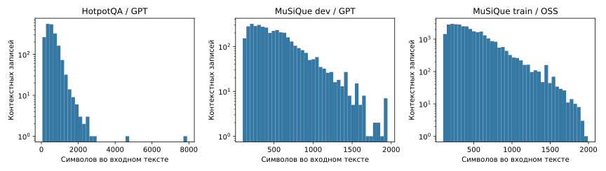
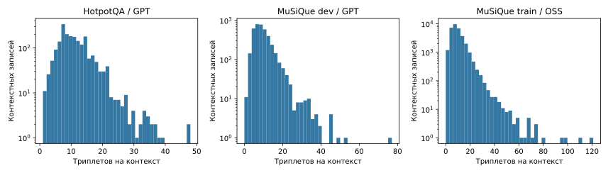
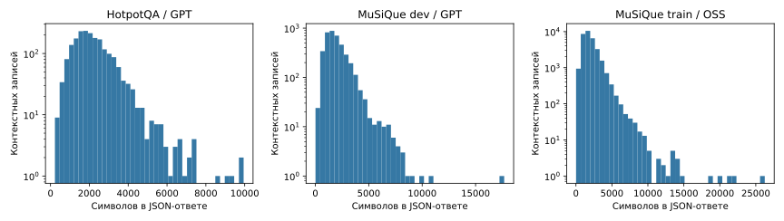
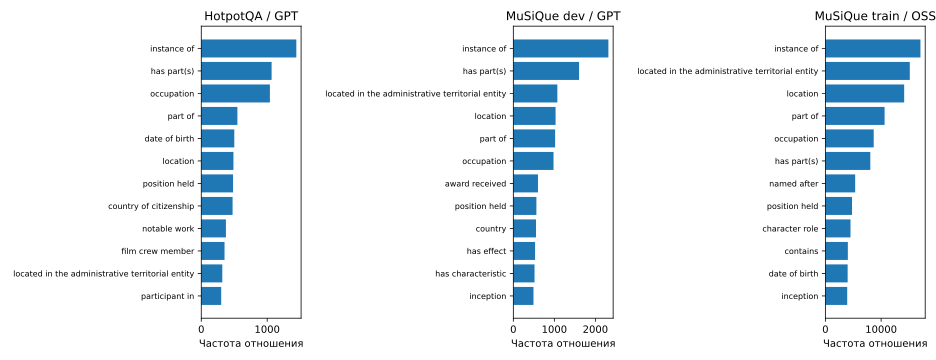
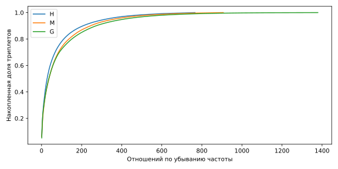
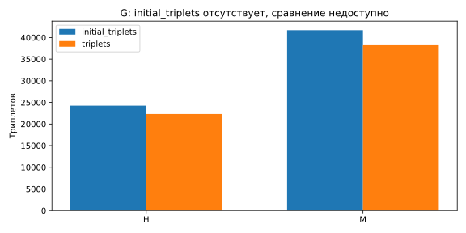
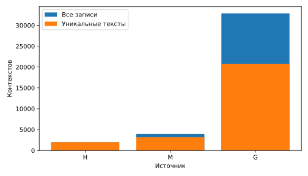

# EDA учительских данных Wikontic Lite

Дата анализа: 12 ноября 2026 года. Анализ выполнен на CPU, без обучения,
инференса моделей или дополнительных вызовов учителя.

## Данные и воспроизведение

Используются три локальных дампа и 38 839 восстановленных контекстов.
[Сопоставление с исходниками](../source_matching.md) выполнено до EDA.
Контрольные суммы источников и дампов повторно проверяются при запуске анализа.

| Код | Источник текстов | Учительский файл |
|---|---|---|
| H | HotpotQA distractor validation | `kg_dump_hotpot_gpt4_1_onto_triplets.json` |
| M | MuSiQue-Ans v1.0 dev | `kg_dump_musique_gpt4_1_onto_triplets.json` |
| G | MuSiQue-Full v1.0 train | `kg_dump_triplets_musique_train_split_occ_openai_gpt_oss_120b_onto.json` |

GPT/OSS в подписях графиков — сокращения по именам файлов, не проверенные идентификаторы
API-моделей. Версии учителя, промпты и настройки генерации требуют отдельного
сопоставления с журналами предыдущих экспериментов.

```bash
python -m pip install -r requirements-eda.txt
python scripts/download_qa_sources.py
python scripts/match_teacher_sources.py
python scripts/eda.py --seed 42
python -m unittest discover -s tests -v
```

Скрипты запускаются из корня проекта с активированным Python 3.12 окружением.
Учительские файлы скачиваются отдельно в `data/teacher/` по
[инструкции HF в README](../../README.md#данные-для-дз-2), с проверкой доступа
и закреплённой ревизией `48caaeef5a103a775392a4b7fa14c90fa94e259f`.
Анонимное скачивание и SHA-256 трёх дампов проверены 14.11.2026.
Скрипт загрузки QA-источников не скачивает учительские ответы.
Прямые версии библиотек закреплены, фактические версии записаны
в [summary.json](tables/summary.json). Полного транзитивного lock-файла нет.

Большие промежуточные таблицы остаются в `data/processed/eda/`:
`context_lengths.csv`, `group_manifest.jsonl`, `diagnostic_contexts.jsonl`.
Они не включаются в публикацию. В этом отчёте сохранены агрегаты, SVG-графики
и небольшая выборка ID и фактов для диагностики.

## 1. Состав и объём

| Показатель | H | M | G |
|---|---:|---:|---:|
| QA-примеров | 200 | 200 | 1 645 |
| Контекстных записей | 1 999 | 3 996 | 32 844 |
| Уникальных точных текстов | 1 997 | 3 201 | 20 726 |
| Записей с хотя бы одним валидным SPO | 1 999 | 3 994 | 32 842 |
| Триплетов в `triplets` | 22 312 | 38 217 | 329 814 |
| Уникальных отношений | 766 | 907 | 1 379 |
| Уникальных непустых типов субъектов/объектов, объединённо | 1 201 | 1 476 | 2 422 |
| Отношений с частотой ≤5 | 410 | 427 | 391 |

Всего в `triplets` — **390 343 записи**, а не 390 343 независимых или корректных
факта. Внутри корпуса повторяются тексты, встречаются неоднозначные отношения
и структурные ошибки. Метрики частот взвешены по всем контекстным вхождениям,
а не по уникальным текстам. Для обучения потребуется дедупликация и ограничение
веса многократно встречающихся абзацев.

## 2. Длины входа и ответа



| Длина текста, символов | H | M | G |
|---|---:|---:|---:|
| Медиана | 502 | 455 | 404 |
| p95 | 1 130,1 | 1 140 | 1 030,85 |
| Максимум | 7 903 | 1 952 | 1 992 |

**Вывод:** большинство текущих единиц обработки — короткие абзацы. У H есть
существенный выброс: длинное описание железнодорожной линии. Равномерный лимит
по среднему значению скроет хвост; перед SFT нужна токенизация и отдельная политика
переполнения. Символы и слова здесь не являются токенами student-модели.



Медианы числа триплетов: 10 / 9 / 9; максимумы: 48 / 77 / 121.
**Вывод:** даже короткий табличный контекст может порождать большой набор фактов.
Проверять нужно не только входной контекст, но и ограничение длины генерации.



| Длина JSON-цели, символов | H | M | G |
|---|---:|---:|---:|
| Медиана | 2 038 | 1 744 | 1 741 |
| p95 | 4 114,2 | 3 803,75 | 3 846 |
| Максимум | 9 944 | 17 678 | 26 249 |

Цель измеряется как `json.dumps({"triplets": ...}, ensure_ascii=False)` со стандартными
разделителями Python. Это старый контракт с типами и qualifiers, не будущий
SPO+evidence. **Вывод:** малый вход не гарантирует малую суммарную длину SFT-примера.
Усечение ответа может создавать ложное впечатление плохого recall; бюджет выхода
и сериализация должны быть одинаковыми для сравниваемых вариантов.

## 3. Распределение отношений





Top-10 отношений покрывают 30,35% / 26,87% / 28,00% валидных SPO-вхождений.
Длинный хвост включает сотни отношений с частотой не более пяти.
**Вывод:** одной micro-метрики недостаточно. В оценке нужны срезы по частоте отношений,
но старые отношения нельзя автоматически считать закрытым списком классов.
Фильтр по train-whitelist может удалять корректные новые отношения. Focal Loss
и балансировка требуют отдельных абляций; эти распределения сами по себе
не доказывают пользу конкретной loss-функции.

Полные частоты доступны в [relations.csv](tables/relations.csv).

## 4. Структура и качество целей

| Наблюдение | H | M | G |
|---|---:|---:|---:|
| Пустых целевых массивов | 0 | 2 | 2 |
| Невалидных SPO из-за пустого обязательного поля | 1 | 5 | 31 |
| Некорректных элементов qualifiers | 0 | 0 | 3 |
| Точных дубликатов полного триплета внутри контекста | 0 | 0 | 0 |
| Повторных SPO без учёта типов/qualifiers | 36 | 70 | 210 |
| Совпадающих имён субъекта и объекта без учёта регистра | 150 | 220 | 274 |
| Триплетов с непустыми qualifiers | 6 784 | 13 392 | 92 400 |
| Триплетов с полем evidence | 0 | 0 | 0 |

Прочитаны все три JSON-файла. Это подтверждает синтаксис сохранённых дампов,
но не частоту успешного парсинга исходных ответов учителя: сырые ответы и журналы
ошибок отсутствуют. Обязательные поля SPO проверяются на строковый тип и непустоту.
Счётчик `invalid_spo` включает несловарные элементы списка и словари с отсутствующими,
нестроковыми или пустыми обязательными полями. `malformed_triple` — его подмножество
для несловарных элементов. Неверный тип самого массива считается отдельно как
`triplets_not_list`, а не как пустой ответ. Проверки типов сущностей, qualifiers,
evidence и буквальных совпадений выполняются только для структурно валидных SPO;
поэтому ошибки qualifiers не увеличивают `invalid_spo`.

**Выводы:**

- 37 структурно невалидных SPO нужно карантинировать до SFT; исходные файлы
  при этом сохраняются. В 38 835 контекстах остаётся хотя бы один валидный SPO.
- Четыре пустых ответа нельзя без аудита считать отрицательными примерами:
  неизвестно, это отсутствие фактов или неудачное извлечение.
- 316 повторных SPO могут различаться временем или другими qualifiers.
  Их нельзя все удалить как дубликаты полного факта.
- 644 self-links — кандидаты на разбор, не автоматические ошибки. В выборке
  есть корректная связь песни и одноимённого альбома.
- Ни одна из старых целей не содержит evidence. Для нового контракта требуется
  отдельное обогащение и проверка; весь абзац не считается доказательством любой связи.

Для субъектов нет буквального совпадения без учёта регистра у 3 024 / 6 287 / 40 088
валидных SPO, для объектов — у 4 153 / 8 219 / 50 662. **Это не hallucination rate**:
возможны акценты, кореференция, нормализованные имена, вывод из контекста или заголовок.
Примеры с расхождением отношений, модальностью и условиями разобраны в
[диагностической выборке](diagnostic_review.md).

## 5. Стадии обработки учительского ответа



В H количество записей уменьшается с 24 250 до 22 312, в M — с 41 703 до 38 217.
Однако точных сохранённых SPO только 8 239 и 11 901 соответственно. Остальные
могли быть удалены, добавлены или переименованы. В G `initial_triplets` отсутствует,
поэтому сравнение стадий для него недоступно, а не равно нулю.

**Вывод:** изменение числа триплетов не измеряет полезность онтологической обработки.
Пример «honored → nominated by» показывает, почему нужно проверять сохранение смысла.
Поля `ontology_filtered_triplets` и `filtered_triplets` не добавляются к `triplets`
как независимые обучающие примеры; их назначение уточняется по коду генерации.

## 6. Повторы, пересечения и группировка



В G из 32 844 контекстных записей только 20 726 имеют уникальный точный текст.
**Вывод:** обычное случайное разбиение строк может одновременно переоценивать
объём данных и давать утечки.

| Пара | Точные общие тексты | После нормализации пробелов | Общие заголовки |
|---|---:|---:|---:|
| H–M | 0 | 1 | 12 |
| H–G | 0 | 5 | 28 |
| M–G | 514 | 514 | 683 |

Нормализация текста — только `" ".join(text.split())`, без изменения регистра,
пунктуации и букв. Заголовки дополнительно приводятся через `casefold()`.
**Вывод:** даже нулевое побайтовое пересечение H с другими наборами не доказывает
независимость. Близкие дубликаты и разные версии статей в этом EDA не искались.

На 514 общих текстах M–G наборы SPO различаются в 512 случаях; средний Jaccard
объединённых по каждому тексту SPO-наборов — 0,161. Он измеряет расхождение целей,
не их качество: иной учитель, настройки и онтологическое преобразование могут давать
разные результаты. Если текст повторялся внутри дампа, для этой диагностики
используется объединение его SPO, без типов и qualifiers.

### Пробное внутреннее разбиение

Сформирован локальный манифест `data/processed/eda/group_manifest.jsonl`:

- единица записи — параграф с учительским ответом;
- группы объединяют одинаковые нормализованные тексты **или** одинаковые
  нормализованные заголовки, включая транзитивные связи между источниками;
- 21 506 групп; крупнейшая содержит 155 записей — около 0,4% корпуса;
- seed 42, около 10% групп выделены во внутреннюю validation;
- 34 996 / 3 843 записей в train/validation до очистки и дедупликации;
- пересечения нормализованных текстов и непустых заголовков между частями — 0.

Это кандидат разбиения, **не финальный gold-test**. Название статьи — консервативный
сигнал общей темы, а не глобальный entity linking. Возможны совпадения названий
разных статей и невыявленные переименования. Если учитель использовал весь QA-контекст,
а не один параграф, границу группировки потребуется пересмотреть.

## 7. Практические решения по результатам EDA

1. Использовать существующие данные как исследовательский пул, не как готовый
   независимый эталон. Официальные имена train/dev не отменяют найденные пересечения.
2. Начать адаптацию с валидных параграфов, убрать повторный вес точных текстов,
   сохранить версии ответов разных учителей для диагностики, не сливать их слепо.
3. Перед изменением контракта проверить qualifiers и неоднозначные сущности.
   При первом обучении использовать только цели, преобразованные без потери смысла
   и дополненные проверенным evidence.
4. Сначала провести токенизацию входа **и** ответа; затем определить контекст,
   лимиты генерации и допустимую политику сегментации.
5. Для оценки подготовить независимые факты с источниками. Небольшой качественный
   разбор 30 примеров полезен для инструкции, но не заменяет эталон.
6. Проверить перенос на научно-технические тексты: нынешние источники — Wikipedia QA,
   в них много биографий, географии, истории, спорта и табличных списков.

Конкретный план данных, моделей, независимой оценки и обучения приведён в
[§2.3 дизайн-документа](../../docs/ml_system_design_doc.md#23-этапы-решения-задачи).

## Ограничения

- Нет независимой оценки полноты фактов и статистической оценки точности учителя.
- Нет токенизации выбранной student-моделью и измерений GPU-памяти обучения.
- Не исследованы близкие дубликаты, не сводящиеся к нормализации пробелов/заголовков.
- Предобучение моделей может содержать Wikipedia и публичные бенчмарки.
- Разбор чувствительных сведений не является исчерпывающей privacy-проверкой.
  Открытые тексты содержат имена, биографические и потенциально чувствительные сведения;
  публичность источника не отменяет ограничений на дальнейшее использование.

## Воспроизводимость расчётов

При повторном запуске с seed 42 получены побайтово одинаковые 14 файлов таблиц,
метаданных и SVG, а также групповой манифест. Сверено соответствие 30 разобранных
фактов детерминированной выборке. Unit-тесты проверяют счётчики, различие
полных дубликатов и qualifier-вариантов, нормализацию, транзитивную группировку,
повреждённые записи и понятный отказ при невозможном разбиении пустого набора
или одной группы. Эти изменения обработки ошибок не меняют статистики текущих дампов.
Это проверка вычислений и выбранных правил, не доказательство полноты семантического
аудита или независимости от всех возможных близких дубликатов.
